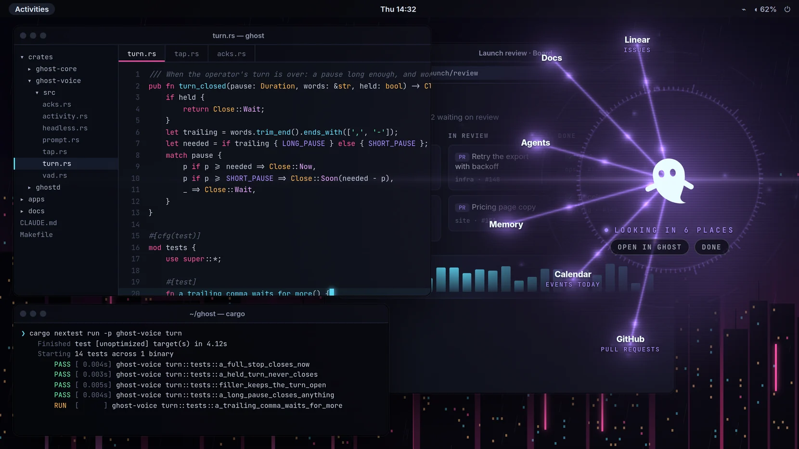
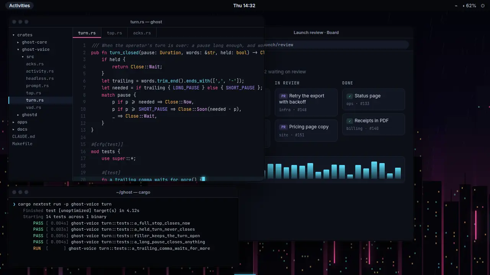
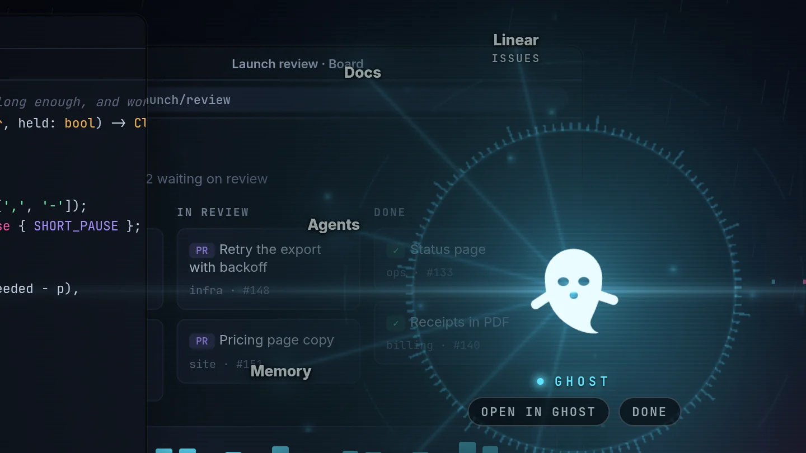
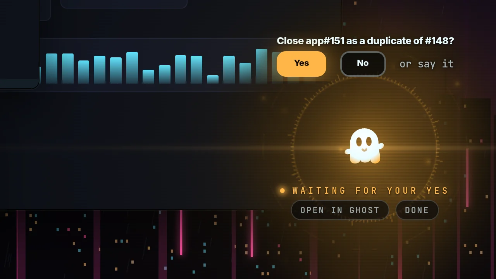
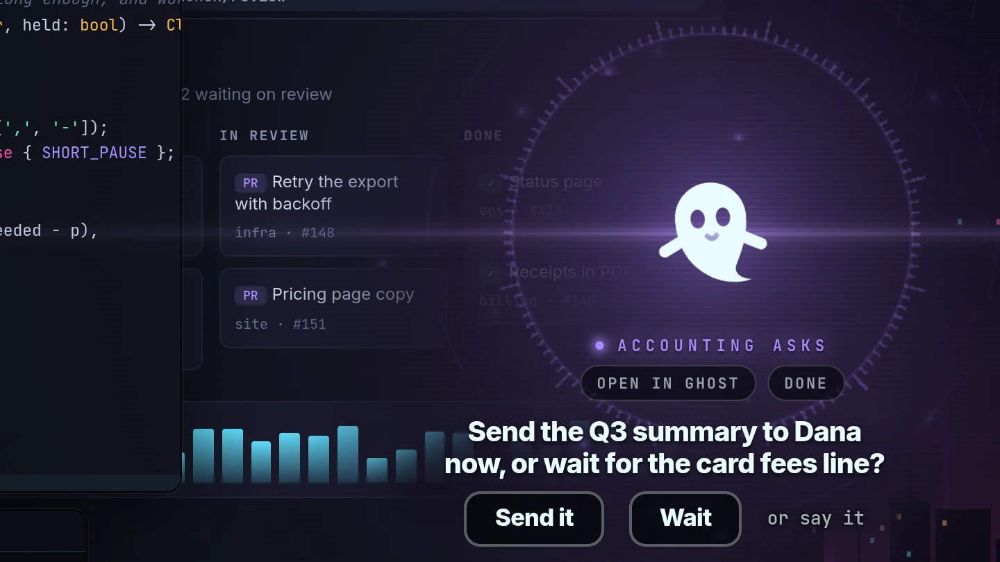
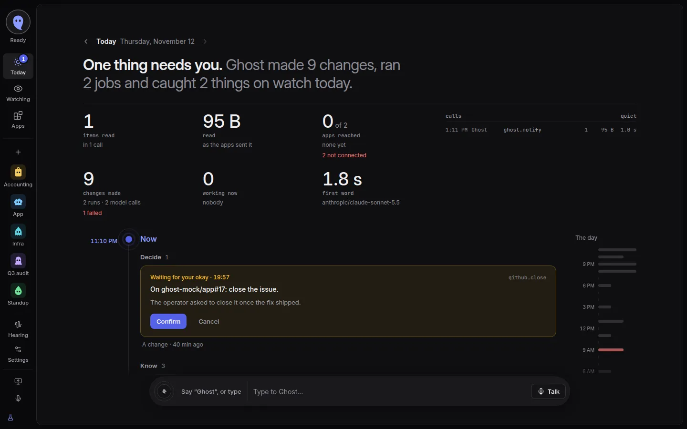

<h1>
  <picture>
    <source media="(prefers-color-scheme: dark)" srcset="docs/brand/lockup-dark.png">
    
  </picture>
</h1>

[](https://github.com/heka-vault/ghost/actions/workflows/ci.yml)

**Ghost floats over your work when you call it.** With the floating room on, say "Ghost" and it comes forward beside
whatever you are doing, with no window: you see it listen, a beam to each app and agent it
reaches for, and its voice moving as it answers. When you are done it falls back to a thin line
at the bottom of the screen.

<p align="center">
  
</p>

Ghost is a voice-first personal assistant that runs on your own Linux machine. Talk to it and
it answers out loud, uses the apps you connect (GitHub, Linear, your calendar, any app that
speaks the Model Context Protocol), and tells you what it changed. It keeps a team of agents,
each with its own job, voice, memory and look; they can work on a schedule with nobody there
and leave what they found on a list for you. A desktop app shows the day, the live
conversation, what Ghost is watching and every change it made.

### Over your desktop

The floating room shows what a voice can't: the state, where Ghost is looking, and a change or
a question that needs your answer, in a card with buttons. It shows no transcript, never takes
the keyboard, and lets every click through except its own buttons. It is off until you turn it
on in Settings › General, and it needs an X11 session or XWayland (GNOME on Wayland has it by
default). More in [docs/floating-room.md](docs/floating-room.md).

<p align="center">
  
</p>

<table>
  <tr>
    <td width="33%"></td>
    <td width="33%"></td>
    <td width="33%"></td>
  </tr>
  <tr>
    <td align="center"><sub>Speaking</sub></td>
    <td align="center"><sub>A change waiting for your yes, in the corner</sub></td>
    <td align="center"><sub>An agent's question</sub></td>
  </tr>
</table>

<sub>Taken from the desktop app's mock (`make screenshots`) over a made-up desktop: the
floating page is the real one; the windows behind it and every word on screen are invented.</sub>

**You decide how much it does on its own.** By default Ghost does what you ask and says what it
did; your permissions name what it must ask about first or never do. Every change is in an
audit log. There is no undo: to reverse something, ask for the opposite change.

**Status.** Ghost is young and built for one person's desk. It works end to end on a stock
machine (this README was checked on a clean Ubuntu 24.04 install), but expect rough edges:
see [What's rough](#whats-rough). Linux only today.

<p align="center">
  
  <br><sub>The desktop app's Today: the day, a change waiting for your okay, and the agents on the rail.</sub>
</p>

## Before you install: what to know

- **It listens.** While it runs, Ghost keeps your microphone open to hear its name (unless you
  turn listening off). Before the wake word, audio goes only to models running on your CPU and
  is not sent anywhere. Details and what is kept: [Privacy](#privacy).
- **After the wake word, your words go to the model provider you choose** (Anthropic,
  OpenRouter, OpenAI, …), unless you choose a local model. Your voice itself leaves the
  machine only if you turn on the optional realtime voice.
- **It keeps things on your machine:** conversation transcripts, an audit log of every change,
  and, with the trained wake detector only, recordings around the wake word to learn your voice
  (see Privacy for what is kept and how to delete it).
- **It acts.** Connected apps are used for real: by default Ghost makes the changes you ask for
  and tells you; set what it must ask about first in Settings › Permissions.
- **It is early software**, built on one desk. Linux only. See [What's rough](#whats-rough).

## Install

### Get started with your agent

Already use Claude Code, Codex, Cursor or another coding agent on this machine? Paste this into it:

```text
Read https://heyghost.app/agents.md in full before you do anything, then set up Ghost on this computer by following it. Before you install anything, tell me what Ghost will do on this computer and wait for my yes. Ask me before any step that needs my password, and never ask me to paste a key or password into this chat.
```

It follows [docs/agent-setup.md](docs/agent-setup.md) (served as
<https://heyghost.app/agents.md>): it tells you what Ghost will do here and waits for your
yes, checks the computer, downloads the latest release and checks its SHA-256, asks you to run
the one `sudo apt install` yourself, fetches Ghost's ears and voice, and connects itself to
Ghost as an outside tool. It never handles your keys: you type those into Ghost.

### By hand

On Ubuntu 24.04 or 26.04 (x86-64), from the [latest release](https://github.com/heka-vault/ghost/releases/latest):

1. **Download** `heka-ghost-desktop_<version>_amd64.deb` (or the `.AppImage`, below).
2. **Install** it: open it with App Center, or
   `sudo apt install ./heka-ghost-desktop_<version>_amd64.deb`. apt brings what it needs
   (WebKitGTK, eSpeak NG, and `pactl` from pulseaudio-utils, the sound tools only).
3. **Open Ghost** from the app menu. The first run walks you through the rest: its ears and
   voice (Parakeet and Kokoro, 2.9 GB, downloaded once by the app with progress; nothing is
   left for you to fetch by hand), connecting a model (a key from Anthropic, OpenRouter or
   OpenAI, or a local Ollama or LM Studio), the microphone, the wake word, a voice, an app, an
   agent and a first question. Each step can be skipped.

**The AppImage** runs on other distributions too: `chmod +x heka-ghost-desktop_*.AppImage`
and run it. It needs FUSE 2 (`libfuse2t64` on Ubuntu 24.04); without it, run it with
`--appimage-extract-and-run`.

**No microphone?** Ghost still works typed: skip the first run's microphone and wake steps
and type to it (the box at the bottom of Today, or the last step). It still downloads its ears
and voice, and it needs a working sound output, since it answers out loud as well as on
screen. Turn listening off (the switch by the brand, or Settings › Sound) to keep it from
looking for a microphone.

**Speakers, not headphones?** Ghost's echo canceller keeps it from hearing its own voice:
the first run's **Set it up**, **Install** in Settings › Sound, **Repair** on the microphone's
note, or `ghostd echo-cancel on` from a terminal (`off` removes it). It is a user service
that runs your system's PipeWire, so it needs no password; Ghost offers it only where it
helps, not on a headset or a microphone that cancels echo itself. On a machine whose sound
runs on PulseAudio rather than PipeWire it can't be set up, and Ghost says so; use
headphones there.

**Updates.** Ghost checks for a new release when it starts and once a day, and says
"Update available" on the rail; Settings › General shows what's new and has **Update and
restart** (the .deb asks for your password once; the AppImage replaces itself). The check is
one request to GitHub carrying nothing about you; turn it off there. Your settings, agents
and memory in `~/.config/ghost` and `~/.local/share/ghost` stay as they are.

## Build from source

You need a Linux desktop with PipeWire (Ubuntu 24.04 or later, Fedora, Arch and the like), about
15 GB of disk, 8 GB of RAM (16 to build comfortably), a microphone and speakers or a headset, and
one of: an Anthropic, OpenRouter or OpenAI key, or a local Ollama or LM Studio.

```bash
git clone https://github.com/heka-vault/ghost.git && cd ghost
scripts/prereqs.sh     # what is missing, and the one command that installs it (it never runs sudo)
make setup             # build, fetch the speech models (~2.9 GB), seed ~/.config/ghost, check
make dev               # the daemon and the desktop app, logging to this terminal; Ctrl+C stops both
```

`scripts/prereqs.sh` names the system packages for Ubuntu/Debian, Fedora and Arch. On Ubuntu it
comes to:

```bash
sudo apt install build-essential cmake pkg-config git curl xz-utils clang lld libclang-dev \
  libssl-dev libwebkit2gtk-4.1-dev libgtk-3-dev libayatana-appindicator3-dev librsvg2-dev \
  libxdo-dev libpipewire-0.3-dev libspa-0.2-dev libpulse-dev libasound2-dev libespeak-ng-dev \
  libopus-dev pulseaudio-utils
```

and the toolchains each come from their own installer: [rustup](https://rustup.rs) (the Rust
version is pinned in `rust-toolchain.toml` and fetched on the first build), Node.js 22 or later
with `corepack enable` (pnpm's version is pinned in `package.json`), and
[uv](https://docs.astral.sh/uv/) for the Python tools.

How long: on a 6-core desktop with a fast connection, `make setup` took about 6 minutes from a
clean clone (the Rust build about 4.5, the downloads the rest) and `make dev` about 4 more the
first time, to build the desktop window. Expect two to three times that on a laptop.

Until a model is connected, the window offers **Finish setup**, the first-run steps: connect a model, let
Ghost hear you, say "Hey Ghost", pick a voice, connect an app, hire an agent, ask something.
Each step can be skipped, and the steps below do the same from a terminal.

## Connect a model

Ghost uses one model connection for everything (ADR 0037). Pick it in **Settings › Model**, or
in `~/.config/ghost/settings.env`, which holds settings only, never a password:

| You have | `settings.env` | The password, in Ghost's vault |
|---|---|---|
| An Anthropic API key | `GHOST_LLM_PROVIDER=anthropic` | `ANTHROPIC_API_KEY` |
| An OpenRouter account | `GHOST_LLM_PROVIDER=openrouter` | `OPENROUTER_API_KEY` (or **Sign in** in Settings, nothing to copy) |
| An OpenAI key | `GHOST_LLM_PROVIDER=openai` | `OPENAI_API_KEY` |
| Ollama on this machine | `GHOST_LLM_PROVIDER=ollama` and `GHOST_LLM_MODEL=<a model you pulled>` | none |
| LM Studio on this machine | `GHOST_LLM_PROVIDER=lmstudio` and `GHOST_LLM_MODEL=<the loaded model>` | none |
| Any address that speaks Anthropic's or OpenAI's API | `GHOST_LLM_PROVIDER=custom`, `GHOST_LLM_BASE_URL=…`, `GHOST_LLM_PROTOCOL=anthropic` or `openai`, `GHOST_LLM_MODEL=…` | `LLM_API_KEY` |

Save the password from the desktop (**Settings › Passwords**) or the terminal; it is read
without echo and never shown again:

```bash
target/debug/ghostd passwords set ANTHROPIC_API_KEY
```

Then, with Ghost running (`make dev`, `make start` for the daemon alone, or
`target/debug/ghostd run` by hand), check it:

```bash
target/debug/ghostd llm test
```

It sends a fixed synthetic prompt and reports how soon the first word comes back and whether
streaming, tool calls and the prompt cache work. Under about a second to the first word feels
like a conversation; past 1.5 s Ghost puts a note on its list saying what would help. A change
to `settings.env` applies from the next session (`make reload` restarts the daemon).

Every `ghostd` command reads `settings.env` itself, so `ghostd run`, `check`, `llm test`,
`passwords` and `listening` behave the same by hand as from `make` or the service. A variable
exported in the shell you start it from wins over the file for that start (an empty one too),
and **Settings › Model** and **Settings › Passwords** say which ones come "from the environment
Ghost was started in"; a password is never read from the file.

**What it costs.** A spoken turn sends about 7,000 tokens of prompt and tools, almost all of it
read from the prompt cache, and gets a sentence or two back. On Claude Sonnet 5.5 that is a
fraction of a cent a turn and a few cents for a ten-turn conversation; a turn that calls
several apps costs a few times that. Claude Haiku 5.5 is about a tenth of it; a local model is
free. Nothing is sent while Ghost is idle.

**The keyring.** The vault's key lives in your login keyring through Secret Service: GNOME
Keyring (Ubuntu and Fedora's GNOME have it), KDE Wallet with its Secret Service enabled, or
KeePassXC's. A locked keyring is waited for and shown on Ghost's list. With no Secret Service at
all (a headless box, a bare window manager) Ghost runs but cannot hold a password, so only a
local model without a key works; install and unlock `gnome-keyring` to fix that.

## Sound

Today Ghost listens on your system's default microphone and speaks through the default
speakers, as PipeWire has them, unless you name others in **Settings › Sound** (or
`GHOST_INPUT_DEVICE` / `GHOST_OUTPUT_DEVICE` in `settings.env`; `pactl list short sources` lists
the names). It does not yet detect what kind of setup you have and choose for it; that is being
built. What to expect by setup:

| Your setup | What to expect today |
|---|---|
| **USB or Bluetooth headset** | The easiest start: Ghost can't hear its own voice. Make the headset the default device (or pick it in Settings › Sound). Bluetooth headsets in their hands-free mode sound worse to the speech model. |
| **Laptop microphone and speakers** | Works, but without echo cancellation Ghost may hear itself, cut its own reply off or answer itself. Run `make echo-cancel` (below) or use headphones. |
| **Webcam microphone with desktop speakers** | As the laptop: two devices on two clocks, so set up echo cancellation; keep the speakers modest. |
| **A conference speakerphone with its own echo cancellation** | Good: the device removes Ghost's voice itself. Make it both the default microphone and speakers, and don't add `make echo-cancel` on top. |
| **A USB microphone array with its own processing** | The setup Ghost has been tuned on. If the array has a speaker output, play Ghost through it so the array's canceller works; make it the default device. If it offers a processed channel, `infra/pipewire/` explains picking it. |

**Echo cancellation.** `make echo-cancel` (or the button in **Settings › Sound**) adds PipeWire's
WebRTC echo canceller as a source named `ghost.mic`, using your default microphone and speakers;
Ghost uses `ghost.mic` on its own when it exists and nothing else is named. `make echo-cancel-off`
removes it. [infra/pipewire/](infra/pipewire/README.md) has the details and the trade-offs.

**The wake word** is read from the speech-to-text by default ("hey ghost", "ok ghost", "ghost,
you there?"). How well it fires depends on the microphone, the room and the music playing: say
it clearly, like a name. `GHOST_DEBUG_AUDIO=1 make daemon` prints what Ghost heard, in your
terminal only.

How fast the local speech models are, measured on a 6-core Intel i5-11600K with no GPU (they
are CPU-only): Parakeet reads a 2.7 s sentence in about 0.45 s, and Kokoro starts speaking a
reply's first clause 0.6 to 0.8 s after it has the words. With the machine busy (a build
running) or held to 4 cores, Kokoro's first clause took 1.5 to 2.3 s. On a 4-core laptop, expect
a second or two more before Ghost starts to answer; the model's own first word is the rest.
`make perf-micro` measures your machine.

## Your first ten minutes

With `make dev` running and the window open:

1. **Wake it.** Say "Hey Ghost". You hear a chime and a greeting; the window shows Listening.
   Ask "what's the capital of France?" and hear "Paris." Say "that's all" to end, or just stop
   talking. Typing works too: the box at the bottom of the window, or
   `make say TEXT="what can you do?"` from a terminal.
2. **Use an app.** A pretend GitHub (`ghost-mock-github`, with repositories `ghost-mock/app` and
   `ghost-mock/infra`) is connected out of the box. Ask "what issues are open in the app repo?",
   then "label 151 as a duplicate". Ghost does it and says so; **Settings › Audit log** has the
   change.
3. **Connect a real app.** **Apps › Add an app** searches the public registry of apps; sign in
   or paste a key and every agent can use it. Make an app ask first: **Settings › Permissions**,
   or `~/.config/ghost/policy.toml`. Then ask Ghost to do something there and answer the yes out
   loud or with the Confirm card. [docs/apps.md](docs/apps.md) has the rest.
4. **Hire an agent.** "Hey Ghost, hire an agent called Ledger to keep an eye on my invoices", or
   **Settings › Agents › New agent**, where you also pick its shape, colour and voice. It
   appears on the left rail; "transfer me to Ledger" hands the conversation over.
5. **Make a schedule.** "Every weekday at nine, check what's open in the app repo and tell me",
   or **Watching › Add schedule**. The run happens with nobody there; its answer lands on
   **Today**. A change it would make that needs your yes waits there instead.
6. **The floating room.** **Settings › General › The room › Float over the desktop** (or the tray)
   shows Ghost over your work while you talk to it, without the window. It needs X11 or XWayland (GNOME on Wayland has XWayland
   by default). See [docs/floating-room.md](docs/floating-room.md).
7. **Stop listening.** Ctrl+Shift+M, the switch by Ghost's name in the window, "Ghost, stop
   listening", or `target/debug/ghostd listening off`. No microphone is open at all until you
   turn it back on (the same ways, except by voice); typing still works.

## What's rough

- **Wake reliability** varies by microphone and room, and with music playing. A headset or a
  good USB microphone does much better than a laptop's built-in one. The trained wake detectors
  the author uses aren't distributed yet; the default reads the wake word from the
  speech-to-text.
- **Reply speed** is mostly the model: a slow provider or a large local model on a CPU makes
  Ghost pause. `ghostd llm test` shows it, and Ghost says on its list when it is too slow.
- **Hardware**: Ghost has been tuned on one setup, a microphone array. Other setups work through the
  default devices but haven't been tuned; open speakers without cancellation echo (see
  [Sound](#sound)). The Hearing test's recorder (`docs/hear-recording.md`) needs `ghost.mic`.
- **The floating room** needs X11 or XWayland and hides during screen sharing; there is no
  native Wayland, KDE or wlroots version yet.
- **The phone app** (`apps/mobile`, Android) needs your own build (`make android`, with the
  Android SDK and JDK 17) and pairing on your own network:
  [docs/phone-protocol.md](docs/phone-protocol.md).
- **Linux only**, x86-64 checked. The release's .deb and AppImage are checked in clean
  Ubuntu 24.04 and 26.04 containers, not yet on many people's machines.
- **First-run sharp edges**: a provider's model list loads from the provider, so it needs the key
  first; an app that won't connect says so on the Apps page and in `make check`.

## Privacy

**Before the wake word, nothing leaves the machine.** Microphone audio goes to the voice
activity detector, the wake word detector and speech-to-text (Parakeet), all running locally on
your CPU. What Parakeet reads while Ghost is idle is checked for its name and then dropped: it
is not logged, stored or shown. With listening off, the microphone isn't opened at all.

**What is kept on this machine**, all under your home folder and never uploaded by Ghost:

- the transcript of each conversation after the wake word, and what agents did on their own
  (`~/.local/share/ghost/ghost.db`), and the audit log of changes;
- recordings you make on purpose in the Hearing test (`~/.local/share/ghost/hear/`);
- **wake takes**, only when the trained wake detector is in use (`GHOST_WAKE_MODE=onnx`; a
  fresh install wakes by reading the transcript and keeps none: Ghost keeps nothing it hears
  before its name): Ghost keeps the sound of each time it thinks it heard its name, on this
  computer, to learn your voice: a few seconds around each wake and each near miss its check
  turned down, what Parakeet read and how sure the detector was
  (`~/.local/share/ghost/wake/takes/`, at most 1 GB, the oldest go first). On by default with
  the detector; turn it off or delete it all in Settings › Sound, label takes in the Hearing
  test and retrain the detector on your own voice with `make wake-train`
  ([docs/wake-takes.md](docs/wake-takes.md));
  deleting `~/.local/share/ghost/` (with Ghost stopped) removes everything Ghost has kept;
- `GHOST_DEBUG_AUDIO=1`, off by default and set only by you, prints what Ghost heard (idle
  included) to your terminal, not to a file.

**What leaves the machine after the wake word:** the words of the conversation (as text), with
Ghost's instructions and the results of the apps it calls, go to the model provider you chose;
nothing does with a local model. Your voice is sent only if you choose the realtime voice
(Settings › Sound, off by default), and then only during a conversation, to that provider.
Connected apps get the requests Ghost makes to them. Passwords are in an encrypted vault keyed
by your login keyring and are never shown, logged or given to the model.

**What Ghost itself fetches:** an installed Ghost asks GitHub once when it starts and once a
day whether there is a new release (one request for the release's `latest.json`, with no
identifier; turn it off in Settings › General › Updates), and downloads a new version only
when you press Update and restart. The first run downloads the speech models once, from their
publishers on Hugging Face and GitHub.

## How it is built

- `crates/`: the daemon `ghostd` (Rust) and its crates: the voice pipeline, the local models
  through ONNX Runtime, the apps client, the write gate, the agents, schedules and the control
  API on a Unix socket. One Cargo workspace with the desktop app's shell.
- `apps/desktop`: the desktop app (Tauri 2 and React). `apps/mobile`: the Android app (Expo).
- `packages/`: the API contract (`openapi.json`, generated from the Rust types), the TypeScript
  client and the shared UI.
- `tools/`: the Python left over: the version script, test oracles, wake tooling.

Start with [docs/architecture.md](docs/architecture.md); the decisions are in
[docs/adr/](docs/adr/), one short file each, and the words in [GLOSSARY.md](GLOSSARY.md).

## Developing

```bash
make help         # every target, grouped by what you are doing
make reload       # after a Rust change, from another terminal: rebuild and restart the daemon
make desktop-web  # the UI in a browser at http://localhost:1420
make ci           # everything CI runs but the bundle; run it before you push
```

- **No daemon needed for UI work:** open `http://localhost:1420/?mock=busy` (or `passive`,
  `session`, `pending`, `firstrun`, `floating` and the rest in
  `apps/desktop/src/design/mock/scenarios.ts`), and `#/gallery` for every component.
  [docs/design-system.md](docs/design-system.md) is the design contract. `make screenshots`
  regenerates the images in this README from the mock.
- **Checks:** `make ci` is rustfmt, clippy, nextest and cargo-deny over the workspace, ruff and
  pytest over the Python tools, typecheck, the API contract, vitest and the desktop build. It
  needs `cargo install --locked cargo-nextest cargo-deny`. Single pieces: `make lint`,
  `make test`, `make typecheck`, `make contract`, `make web`.
- **Performance** is a feature ([docs/performance.md](docs/performance.md)): `make perf` runs
  scripted conversations through the real pipeline with no microphone and no tokens spent,
  `make perf-micro` times the speech models, `make latency` shows where your recent turns spent
  their time.
- **Other tools reaching Ghost:** Claude Code, Cursor and the like can talk to Ghost as an app
  (`ghostd mcp add <name>`, [docs/connect-ghost.md](docs/connect-ghost.md)).
- **Settings:** [.env.example](.env.example) lists every setting with what it does.

Contributing, filing an issue and what to put in it: [CONTRIBUTING.md](CONTRIBUTING.md).

## More docs

| Doc | What |
|---|---|
| [docs/architecture.md](docs/architecture.md) | The design: components, how a conversation flows, how changes stay safe |
| [docs/agent-setup.md](docs/agent-setup.md) | The setup guide a coding agent follows (heyghost.app/agents.md) |
| [docs/apps.md](docs/apps.md) | Connecting apps: the catalog, sign-in, keys, local packages |
| [docs/folder.md](docs/folder.md), [docs/skills.md](docs/skills.md) | Ghost's folder: rules, agents, watches, skills |
| [docs/tools.md](docs/tools.md) | Every tool Ghost's agents have, and its default |
| [docs/realtime-voice.md](docs/realtime-voice.md) | The optional realtime speech-to-speech voice |
| [docs/releasing.md](docs/releasing.md) | Versions, the bundle and the models it carries |
| [docs/site.md](docs/site.md) | heyghost.app: the site, its hero, deploying it to GitHub Pages |
| [docs/benchmarks/](docs/benchmarks/) | Measurements |
| [docs/original/](docs/original/) | The first product documents (working title VoiceTriage), kept as history; the ADRs win where they differ |

## License

[MIT](LICENSE).
