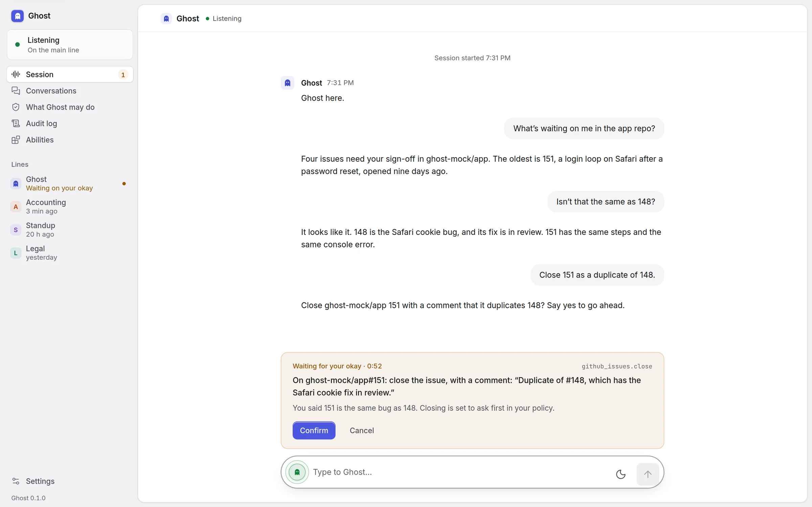
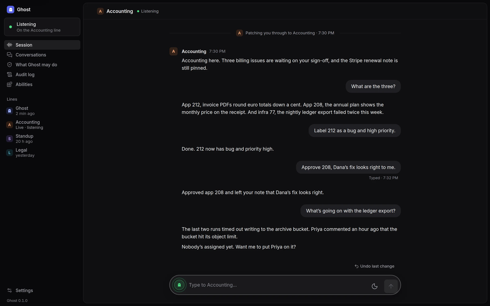
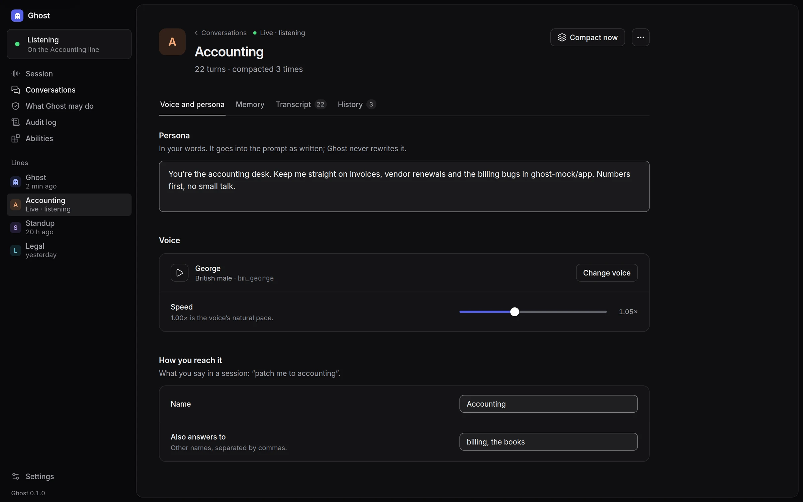
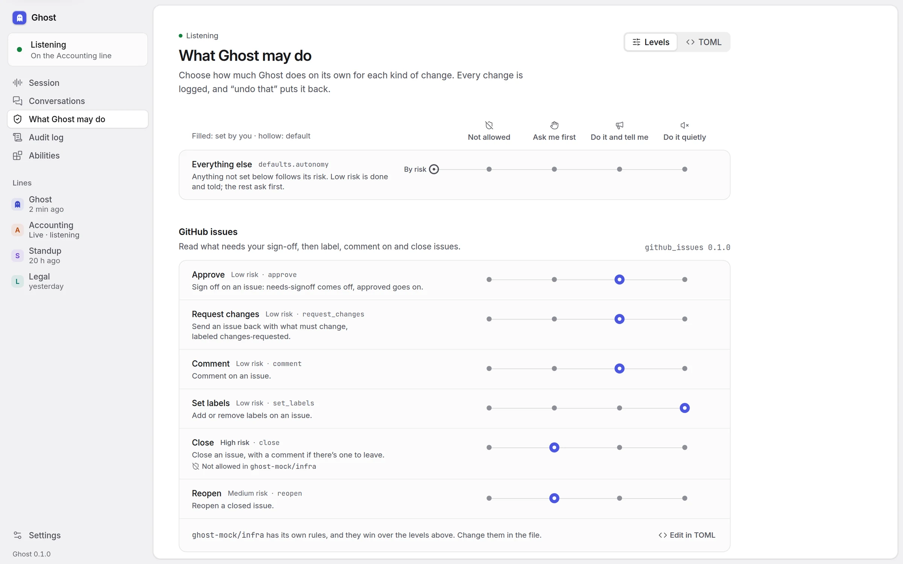
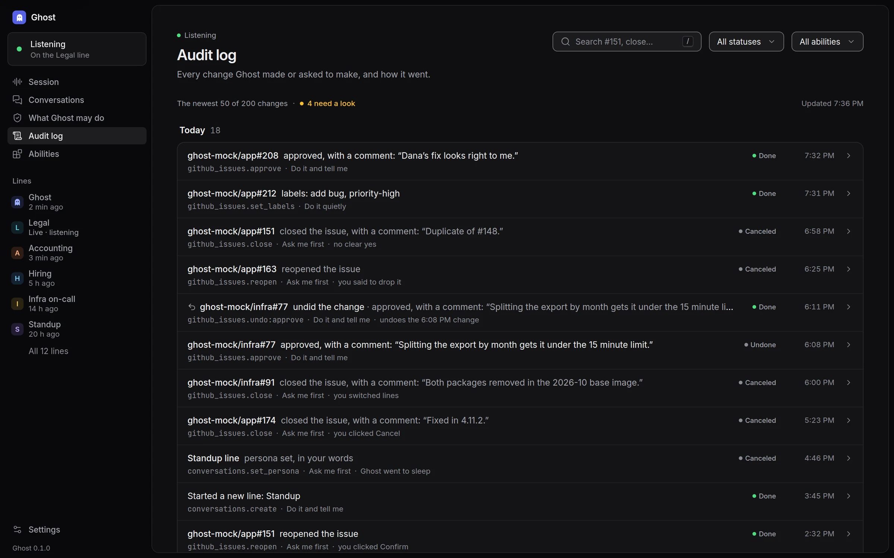
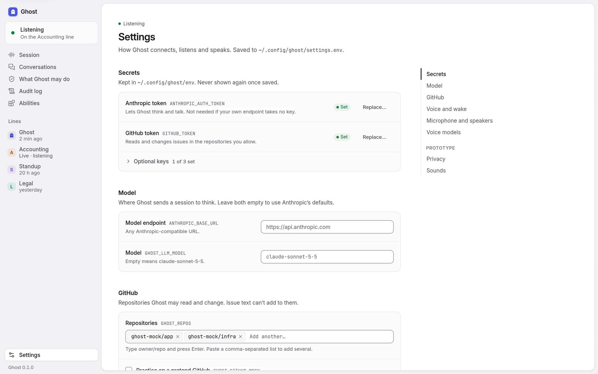
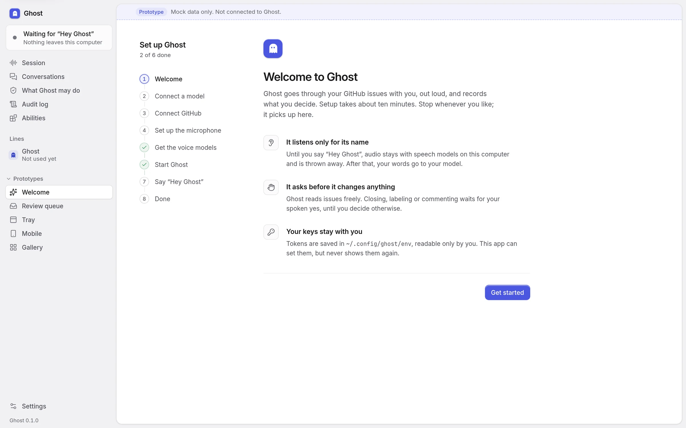
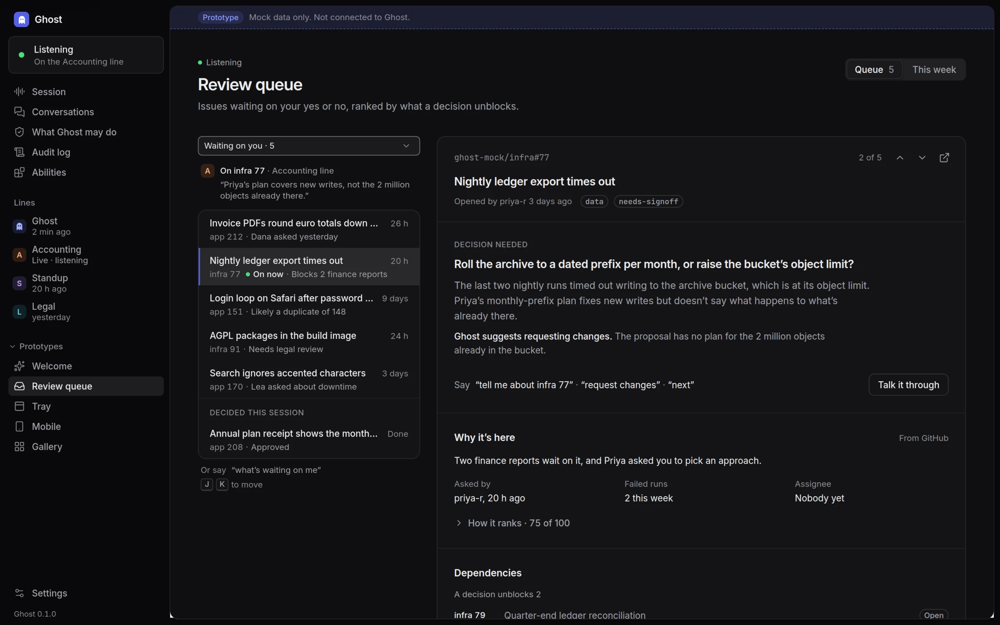
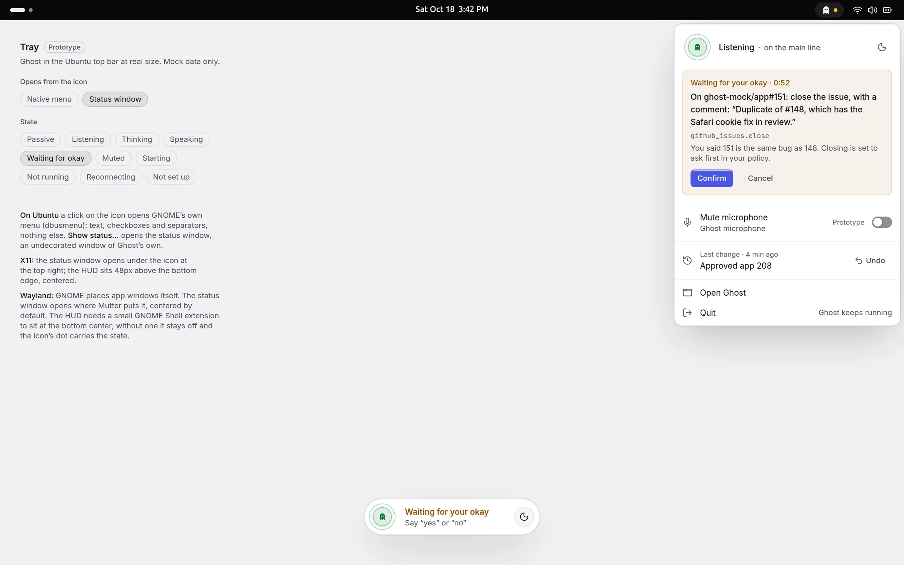
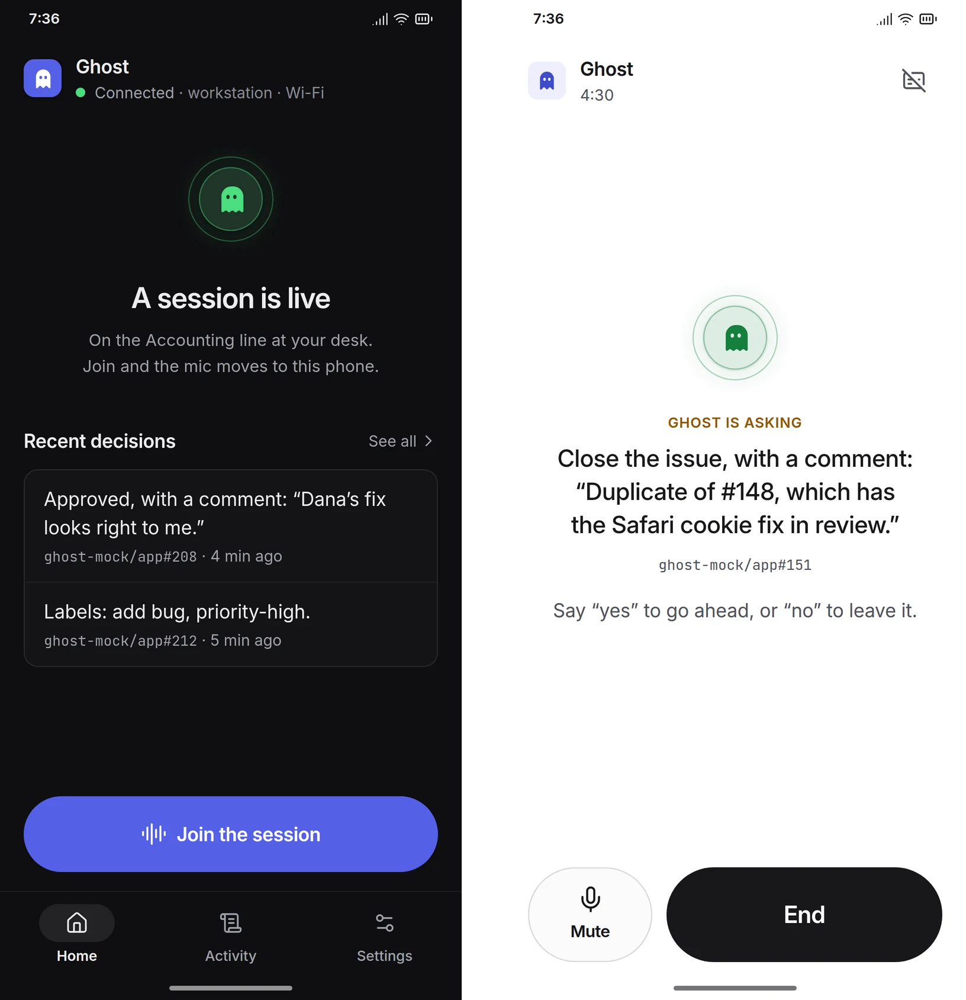

# Ghost

Ghost is a voice-first assistant for triaging GitHub issues. Say "Ghost" at your desk, ask what needs your sign-off, talk through the options, and approve or request changes without opening the issue tracker. You decide how much it does on its own: by default it labels and comments as you ask and tells you in passing, and asks before closing anything. Change your mind and Ghost changes it back, the same way.

<p align="center">
  
</p>

Ghost is the name it goes live under. The original product documents use the working title **VoiceTriage**.

Ghost is a personal tool that runs entirely on your own Linux machine:

- **Wake word** detected locally. Idle audio never leaves the machine.
- **Speech-to-text and text-to-speech** run locally on CPU (Parakeet and Kokoro).
- **Conversation** is built on [Pipecat](https://github.com/pipecat-ai/pipecat). No media server and no cloud voice platform.
- **The LLM** is reached through any Anthropic-compatible endpoint, or OpenRouter's (`GHOST_LLM_ENDPOINT=openrouter`).
- **GitHub** is reached with a fine-grained personal access token scoped to the repositories you choose.

It costs nothing to run beyond the LLM calls.

## Status

First increment in progress: the `uv` workspace exists, the write gate and the GitHub
issue skill are implemented with tests, and the desktop daemon runs the voice loop
with a local transcript matcher as the wake phrase until a wake model is trained. Start
with [docs/architecture.md](docs/architecture.md) and the decisions in [docs/adr/](docs/adr/).

## Run it

Needs Python 3.12 (via `uv`) and PipeWire with the PulseAudio shim.

```bash
make sync            # uv workspace
make echo-cancel     # echo-cancelled mic "ghost.mic" as a user service; without it Ghost hears itself
make env             # render ~/.config/ghost/env from the secrets store (or: cp .env.example .env and fill it in)
make check           # config sanity
make run             # loads models (~3 s warm), then listens for "hey ghost"; Ctrl+C stops it
make wake            # optional, from another shell: trigger a wake by hand
```

Say "Hey Ghost", or "Ghost, you there?" (`GHOST_WAKE_PHRASES` to change them; phonetic
near-misses such as "hey guys" count too, `GHOST_WAKE_FUZZY=0` for exact only). Words
in the same breath are the first request: "hey ghost, what needs me?".

When Ghost does not react the way you expect, run `GHOST_DEBUG_AUDIO=1 make run`: it
logs what Parakeet heard (also while passive), VAD starts and stops, wake matches and
misses, barge-in decisions, and confirmation verdicts. It is off by default and logs
only to your terminal.

While it runs, `make status` shows the daemon's state and `make say TEXT="..."` types a turn
to it through the control socket (`$XDG_RUNTIME_DIR/ghost/api.sock`), which is what the
desktop app uses. `make help` lists the rest (`test`, `lint`, `start`/`stop` for a background daemon,
`~/.config/ghost/settings.env`, which `make env` seeds and folds into the rendered file.

The model is reached through `ANTHROPIC_BASE_URL` with `ANTHROPIC_AUTH_TOKEN` by default.
`GHOST_LLM_ENDPOINT=openrouter` in `settings.env` sends it to OpenRouter's Anthropic API
instead, with `OPENROUTER_API_KEY` from the secrets store and `GHOST_LLM_MODEL` mapped to
OpenRouter's id (`claude-sonnet-5-5` is `anthropic/claude-sonnet-5.5`). `make check` prints
which endpoint and model are in use, never a key. `make latency` shows where recent turns
spent their time ([docs/benchmarks/latency-harness.md](docs/benchmarks/latency-harness.md)).

The phone app joins over the home LAN only (ADR 0016). Set `GHOST_PHONE_LISTEN` in
`settings.env` to the workstation's LAN address and a port, for example
`GHOST_PHONE_LISTEN=192.168.1.20:8765`, restart, and pair from the desktop app (it shows
a six-digit code for two minutes). If `ufw` is on, allow the port and UDP from the LAN,
because aiortc picks its UDP ports at random:

```bash
sudo ufw allow from 192.168.1.0/24 to any port 8765 proto tcp
sudo ufw allow from 192.168.1.0/24 proto udp
```

Say "what needs me?", talk it through, and "that's all" when done. Ghost uses every
app you connect: it looks things up, makes the changes you ask for, and says what it did.
What you want blocked, or asked about first, is in `~/.config/ghost/policy.toml` (seeded
by `make env` from `infra/policy.example.toml`): `block`, `ask`, `quiet` and `allow`
rules over an app, a tool or its arguments, and a `mode` (`open`, `ask`, `read-only`) for
the rest. Every change is logged; to reverse one, ask Ghost for the opposite change. The
connected apps are in `~/.config/ghost/apps.json` (seeded from `infra/example/` with a
pretend GitHub); `ghostd check` and the desktop's Apps screen show what each one gave.
Ctrl+C stops the daemon; a goodbye only ends the conversation.

Deploy as a user service with [infra/systemd/](infra/systemd/) and set up echo
cancellation with [infra/pipewire/](infra/pipewire/). To teach Ghost something new,
connect an app ([docs/apps.md](docs/apps.md)): from the desktop's catalog (sign in, an API
key, or a package that runs on this computer), by address, or by pasting another tool's
config. A department is a folder with its rules, permissions, skills and agents
([docs/departments.md](docs/departments.md)); skills are folders of instructions
([docs/skills.md](docs/skills.md)). `ghost-mock-github` stands in for GitHub before you
connect the real one.

## Desktop app

`apps/desktop` is a Tauri 2 app (React) that talks to the daemon over its socket. Speaking
is the product; the app is the companion: the live session with a Confirm card for changes
that need your okay, your agents grouped by department and their voices, the departments
themselves, the apps you connect and the catalog to connect more, permissions, the audit
log, skills and settings. It follows the system's light or dark theme.

<table>
  <tr>
    <td width="50%"><br><sub><b>Session.</b> A live session, transferred to Accounting.</sub></td>
    <td width="50%"><br><sub><b>Agents.</b> Each agent keeps its own voice, persona and memory, in its department.</sub></td>
  </tr>
  <tr>
    <td><br><sub><b>Permissions.</b> Everything runs unless you block it or want to be asked first.</sub></td>
    <td><br><sub><b>Audit log.</b> Every change Ghost made or asked to make, and how it went.</sub></td>
  </tr>
  <tr>
    <td><br><sub><b>Settings.</b> Secrets are write-only: the app only learns set or not set.</sub></td>
    <td><br><sub><b>First run</b> (prototype). Setup in eight steps, from model key to the first “Hey Ghost”.</sub></td>
  </tr>
  <tr>
    <td><br><sub><b>Review queue</b> (prototype). What is waiting on your sign-off, and why.</sub></td>
    <td><br><sub><b>Tray</b> (prototype). Status and the waiting change from the top bar.</sub></td>
  </tr>
</table>

<p align="center">
  <br>
  <sub><b>Phone</b> (prototype). Start a session, answer by voice, end it. No always-on listening.</sub>
</p>

The prototypes are designs for screens in the [charter](docs/original/prd.md) that have no
API yet; they render only with mock data. Screenshots are taken from the mock scenarios.

Nothing needs installing to work on it: run the daemon from the checkout (`make run`) and
either `make desktop-dev` (the Tauri window with hot reload) or `make desktop-web` (the same
UI in a browser; Vite proxies the socket). Both talk to whichever daemon owns the socket,
packaged or not. In development, `?mock=<scenario>` (for example `?mock=pending` or
`?mock=busy`) runs the UI against a built-in mock daemon instead, and `#/gallery` shows every
component in every state. The design rules are in
[docs/design-system.md](docs/design-system.md). `make deb` builds the installable packages.

## Docs

| Doc | What |
|---|---|
| [docs/architecture.md](docs/architecture.md) | Current design: components, how a conversation flows, how writes stay safe |
| [docs/adr/](docs/adr/) | Decisions, one per file |
| [docs/design-system.md](docs/design-system.md) | The desktop app's design system: tokens, components, page patterns, copy, mock scenarios |
| [docs/benchmarks/](docs/benchmarks/) | Measured speech-model performance on the target workstation |
| [docs/original/](docs/original/) | The original VoiceTriage PRD and technical specification, kept unchanged. Where they differ from the ADRs, the ADRs win |

## License

[MIT](LICENSE)
