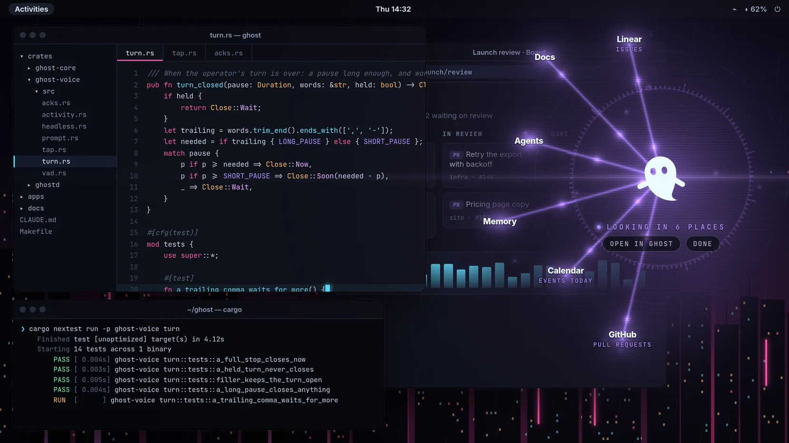

# The floating room

ADR 0059. The room posture without a window: Ghost is a thin line of light at the bottom edge
of a monitor until its name is called, then comes forward over the desktop with no
application chrome, and goes back to the line when the session ends. The windowed app (Today,
the briefing) stays the place you open on purpose.

*From the mock over a made-up desktop (`make screenshots`); the loop and the other pictures are
in the [README](../README.md#over-your-desktop).*

## Turning it on

Settings › General › The room › **Float over the desktop**, or the tray's **Float over the
desktop**. Off by default. Under it, **Ghost appears on**: the other monitor (default), a
named monitor, or where I am; **Where on the screen**: beside your work (default: the owner,
seeing it come forward on the other monitor in a column rather than over the whole screen, "I
liked Ghost showing up without taking the full screen"), in the corner, or in the centre; and **Captions**: off (default), when the sound is off, or always.
The choices are kept beside the window
(`~/.config/dev.heka.ghost/floating.json`), not in Ghost's folder: it is how this desk shows
Ghost, like the room's own delays.

When it is on and you call Ghost while the main window isn't the one you are using, the
session comes forward over the desktop. If the main window is focused, the session stays in
it (and goes to its room after 20 s, as before). A room you hold in the window (Ctrl+.) wins.

## Where it works

| Desktop | Floating room |
|---|---|
| X11 session | Yes |
| GNOME on Wayland with XWayland (the default) | Yes: only this window goes through XWayland, the main window stays native |
| A Wayland session without XWayland | Refused with a sentence in Settings; the switch is off |
| GNOME native Wayland for this window | Not shipped: no keep-above and every map takes the keyboard (the spike, PR #84) |
| KDE, wlroots (layer-shell), macOS, Windows | Later |

## What it does

It is a voice, so it shows no transcript: not your words, not Ghost's reply. What it shows is
the state, where Ghost is looking, and only what sound can't carry.

- **At rest**: one 56×2 px line of light at the bottom centre of the monitor; a struck red
  microphone when Ghost isn't listening (ADR 0057). Nothing runs: no frame loop, Wisp is not
  mounted, the input shape is empty, so every click goes through.
- **Forward**: Ghost comes in from depth, beside your work by default (a column at the edge
  away from it), with a dim that stays in an oval around Ghost. Under Wisp, a few words
  (Listening, Listening to you, Looking in GitHub, Waiting on the model · 6 s, Ghost, Goodbye)
  and two small buttons: **Open in Ghost** and **Done**.
- **Where Ghost is looking**: every app and agent a turn reaches for is a named place with a
  beam from Ghost (GitHub · issues, Calendar · events today, Memory, Docs, Agents). A place is
  lit while its call runs, the answer comes back as light the size of what it brought, and a
  quiet trace stays for the rest of the turn. Ghost's own lookups (its memory, its docs) count.
- **A yes or a question**: the question in a fixed card, three lines at most, and its answers
  as one-word buttons (Yes, No; an agent's choices), "or say it". Clicking is the same as the
  window's Confirm. Nothing else on the surface takes a click but Open in Ghost and Done.
- **Captions** (a setting, off by default): Ghost's own words while it speaks, two lines at
  the bottom of its area. "When the sound is off" reads the default output once per reply
  (`wpctl get-volume @DEFAULT_AUDIO_SINK@`, read only): muted or under 8%. Where that can't be
  read the output is not taken as off.
- **Hold**: the line, with "On hold · say “Ghost” to pick up" over it.
- **Done**: Wisp falls back into depth and the light drops to the line, once the goodbye's
  voice has been quiet 0.7 s, and after 4 s at the most.

**Sending it away**: say "Ghost, that's all" (or "bye Ghost", "goodbye"), click **Done**, or
bind a key: GNOME Settings › Keyboard › Custom Shortcuts, command `ghostd sleep` (the surface
never takes the keyboard, so a key has to be the desktop's). Each ends the session. A click on
empty space can't: everywhere Ghost doesn't draw a button, the click goes to your work.

It never takes the keyboard (the window refuses input focus and is never mapped with it) and
everything it shows is what the window would show, under the same rules (#73: never your
words while you speak).

**Nothing runs off the screen** (`src/floating/layout.ts`, tested on 1920×1080, 1280×720,
1024×600, portrait and 4K): everything is inside a safe area (48 px from the top, 28 px from the
other edges) and within a share of the monitor (36% beside the work, 16% in the corner, 45% in
the centre), scaled by the monitor's shorter side; nothing is sized from what is said.

Reduced motion: no zoom, no scan, one frame per change. Forced colours: the glows go. Screen
readers: one polite status line per change (the state, and the reply whole when it starts);
a yes or a question is an `alertdialog` named by its question.

### Why the beams didn't show (2026-11-12)

In the owner's first live use the working state showed only the corner list of calls. The
beams were drawn in the `thinking` scene only, and the daemon's phase follows the audio
(`ghost_voice::tap`: `speaking` from Ghost's first sound, `listening` when it stops), so with
Ghost saying "One sec." over its calls the scene was `speaking` or `listening` while they ran.
And the call was 91 ms: lit for three frames. Now the calls themselves make the working state
whatever the phase, the reach is drawn in every forward scene but a yes, a question and the
goodbye, and a call is lit for 750 ms at least. The label read "Listening to you" over a reply.
The log of that moment wasn't kept, so the cause is the likeliest one in the code, not a
replay: the page kept the last reply on screen until a newer turn of the operator's closed,
and an open turn (`you_started`) ranked above Ghost's voice, so a turn the VAD opened after or
over the reply (the operator going on, the room, the canceller's first half second) showed
"Listening to you" over the old reply. Now Ghost's voice wins over an open turn and no reply
is shown at all.

## Screen sharing

While the floating room is on, the shell asks mutter every two seconds whether a screen-cast
or remote-desktop session exists (D-Bus introspection of `/org/gnome/Mutter/ScreenCast/Session`
and `/org/gnome/Mutter/RemoteDesktop/Session`: a child node is a session). Every capture on
GNOME goes through one: a browser's meeting through the portal, OBS, GNOME's own recorder,
remote desktop. Not seen: a program that grabs XWayland's pixels itself (`ffmpeg -f x11grab`)
and any desktop other than GNOME; Settings says so when it can't tell, and the tray switch
turns the floating room off at once.

What it does then is the operator's choice, Settings › General › The room › **While my screen
is shared** (`floating.json`'s `while_shared`, `src-tauri/src/floating/share.rs`):

- **Hide Ghost** (the default, and what it always did): the surface draws nothing at all, not
  even the line, and a spoken session shows in the window. Nothing changes for anyone who
  doesn't choose otherwise.
- **Show Ghost**: Ghost floats in the share as anywhere else, wearing a **Screen shared** mark
  (a red recording dot on a dark pill, above the label under Wisp, and above the line at rest)
  so the operator always knows the audience sees it.
- **Ask each time**: when a share starts, a small card low on the surface's monitor asks “Your
  screen is being shared. Show Ghost in it?” with **Show** and **Hide**, and nothing else of
  Ghost is drawn. The card is itself in the share, so it says nothing more and leaves after
  20 s, taking the share as Hide.

Whatever the choice, the tray's **Show Ghost in this share** (usable only during a share) puts
Ghost in or takes it out for that share only; the card's answer is the same. Both are forgotten
when the share ends, and the next share starts from the setting again.

**Sharing one window never includes the floating room**: a window share is that window's own
picture, and the surface is another window. To show Ghost with a window share, share the
stage (below).

### What a capture sees (measured 2026-11-13)

On the workstation (GNOME Shell 50.1 on Wayland, two 1920×1080 monitors, the surface through
XWayland, the mock session playing), with captures started without a click: GNOME's own
recorder through its D-Bus interface (`org.gnome.Shell.Screencast.Screencast`, which records
as long as the caller's bus connection stays open) and mutter's screen-cast API directly
(`org.gnome.Mutter.ScreenCast`: `RecordMonitor` is what the portal gives a browser's "entire
screen" and OBS; `RecordWindow` what it gives "a window"), frames read from the PipeWire
stream with `pipewiresrc`.

1. **A whole monitor**: the floating surface is in every frame, on either monitor, in GNOME's
   recorder and in mutter's monitor stream alike, with its transparency (the desktop shows
   through) and the oval dim intact. A browser meeting's and OBS's "entire screen" take the
   same stream through the portal, so they see the same; what each meeting then does to the
   picture (scaling, compression) is its own. Each capture showed as a mutter session node the
   moment it started, so the detection above sees all of them.
2. **One window**: an ordinary window recorded alone while Ghost floated over it on the same
   monitor carried only that window; the monitor stream taken at the same time showed Ghost
   over it.
3. **The surface as a window of its own**: the portal's window list is gnome-shell's
   `Introspect.GetWindows`, which keeps every window of type normal that isn't
   override-redirect, so the floating surface ("Ghost", normal, skip-taskbar) is offered. A
   transparent, undecorated XWayland window recorded alone arrives as RGBA: its transparent
   pixels are (0, 0, 0, 0) and the translucent ones premultiplied, so a meeting (which drops
   the alpha) shows it on **black**, darker where it was see-through: no garbage, but no
   backdrop either, and at rest a black frame with a thin line. That is why there is a stage.
   The real surface can't be given the focus (it refuses it), and mutter's window ids are
   closed to ordinary clients, so it was measured with a test window of the same kind; the
   owner's check below has the two-minute look at the real one.

## Ghost on stage

The tray's **Ghost on stage**, or Settings › The room › **Open the stage**: the floating
room drawn in an ordinary window titled **Ghost · Stage** (`stage.html`,
`src-tauri/src/floating/stage.rs`), on an opaque designed backdrop, driven by the same live
events as the floating room. In a meeting, share that window; or record it. It shows what the
floating room shows (Wisp, the state, where Ghost is looking, a yes or a question) in the
middle of a dark stage; at rest Ghost waits there with “Say “Ghost”” rather than as a line; a
session comes forward whichever window has the keyboard; Ghost's own words are captioned for
people who may not hear it (never the operator's); and it has no Open in Ghost or Done. It
never hides from a share: it was opened to be seen. It is a window of the main process,
native wherever the main window is, and works where the floating room can't (it needs no X11).
Close it like any window. `stage.html?mock=floating` on the dev server plays the mock session
on it.

Measured as above: the stage page in a WebKitGTK window recorded alone with `RecordWindow`
is the stage and its title bar, opaque, nothing behind it.

## What the people on the call hear

Seeing Ghost is half of it. Ghost's voice plays on the speakers (or headphones), and a meeting
sends only the microphone it was given. The honest options on Linux with PipeWire:

1. **The microphone hears the speakers.** Works only with open speakers and a microphone that
   doesn't cancel them, and then the meeting's own echo cancelling and noise suppression decide
   what survives: they cancel what the meeting itself plays (the other people), not Ghost, so
   Ghost usually gets through, quieter and roomier than your voice. **On this desk it doesn't
   work**: the reSpeaker's chip cancels everything played through its own output, Ghost
   included. Measured 2026-11-13 with a speech-like test signal through the speakers: the
   webcam's microphone heard its harmonics 23.7 dB above the room, the reSpeaker's processed
   output 5.4 dB. A meeting using the reSpeaker as its microphone carries Ghost at a whisper.
2. **Share the system's sound with the screen.** On Linux, Chrome shares a tab's sound but not
   the system's with an entire screen or a window (that is Windows and ChromeOS only, see
   above), and Firefox shares none; the Zoom and Teams Linux clients have a "share sound"
   option of their own whose behaviour depends on their build (not checked). Not something to
   count on.
3. **A microphone with Ghost mixed in** (recommended): **`make demo-audio`**
   (`scripts/demo-audio.sh`). For the length of the demo it makes a source **Ghost and your
   microphone**: your microphone (`ghost.mic` when the echo canceller made it, else the
   default, or `GHOST_DEMO_MIC`) and Ghost's voice (the `ghost-playback` stream, linked in each
   time a session opens it) mixed into a sink nobody hears. Choose it as the meeting's
   microphone; Ghost's voice still plays where it always does. Ctrl+C removes everything it
   made. Measured: the test voice played as `ghost-playback` came through the new source
   28 dB above the room. Ghost's own audio input is not touched.

**What Ghost hears of the call.** The other people's voices come out of the speakers. Ghost
listens for its name in whatever reaches its microphone: someone on the call saying “Ghost”
can wake it, and once a session is open their words can be taken as yours. On this desk the
reSpeaker cancels what the speakers play, which helps but isn't a guarantee. For a demo:

- **Wear headphones** and run `make demo-audio`: the call can't reach Ghost's microphone, and
  the audience hears Ghost through the mixed microphone. This is the setup to use.
- On open speakers, tell the room you are about to call Ghost, keep sessions short (“Ghost,
  that's all” when done), and use the tray's Stop listening while others talk at length.
- A yes to a change is still yours only: the gate waits for your words in your own session
  (ADR 0017), but a voice from the call that sounds like a yes is heard as one. Don't demo a
  change that matters on open speakers.

### On other desktops (from their documentation, not measured)

- **KDE Plasma (Wayland)**: KWin keeps an XWayland window above and honours its input shape,
  so the surface itself should work as here, and KWin has layer-shell for a native one later.
  But there is no mutter to ask, so a share reads as unknown: Settings says so and the tray
  switch is the answer. A portable way to see a share would be to watch PipeWire for the
  compositor's screen-cast video nodes, as Waybar's privacy module does; not built.
- **Hyprland**: its event socket reports `screencast` when a client's screen-copy state
  changes ([wiki](https://wiki.hypr.land/IPC/)), which could feed the same choice. Not built.
  **Sway**: no such event; the PipeWire watch above would be the way.
- **Windows**: a window can leave itself out of every capture
  (`SetWindowDisplayAffinity(WDA_EXCLUDEFROMCAPTURE)`, Windows 10 2004 and later,
  [docs](https://learn.microsoft.com/en-us/windows/win32/api/winuser/nf-winuser-setwindowdisplayaffinity)),
  so Hide would need no detection at all: Ghost would stay on the operator's screen and be
  absent from the share. Show is simply not setting it.
- **macOS**: `NSWindow.sharingType = .none` used to do the same, but since macOS 15
  ScreenCaptureKit, which meetings now use, is reported to ignore it
  ([tauri#14200](https://github.com/tauri-apps/tauri/issues/14200),
  [electron#48258](https://github.com/electron/electron/issues/48258)); detection would be
  needed there too.
- **System sound in a browser meeting**: Chrome shares tab audio on every desktop, and the
  whole system's sound with an entire screen only on Windows and ChromeOS
  ([addpipe](https://addpipe.com/getdisplaymedia-demo/),
  [mdn/content#25307](https://github.com/mdn/content/issues/25307)): on Linux and macOS the
  mixed microphone below is the way.

## A full-screen app

A focused full-screen window (a game, a video, a presentation) is left alone: Ghost comes
forward on another monitor instead, and with only one monitor it does not come forward (the
voice goes on). mutter keeps a focused full-screen window above windows that keep themselves
above, so the line is under it too. This is known for an X11 app from the X11 layer; for a
Wayland app only with the helper below.

## Which monitor, and the helper

`floating::place::choose` is a pure function of the choice and what is known. "Where I am" is
the focused window's monitor, else the pointer's. Measured on GNOME Shell 50.1 under XWayland
(2026-11-12, `heka-ghost-desktop --floating-check`):

- `XQueryPointer` answered `942,1079` at every read across 40 minutes. XWayland only learns
  the pointer while it is over an X window, so this is where it last crossed one; whether the
  pointer moved in those minutes is item 1 of the owner's check below. Not believed under
  XWayland.
- `_NET_ACTIVE_WINDOW` was `0x400003`, a window not in `_NET_CLIENT_LIST` (mutter's own),
  while native Wayland windows had the focus. Only a focused X client counts.
- `_NET_CURRENT_DESKTOP` follows the workspace.
- `org.gnome.Shell.Introspect` and `Eval` are closed to ordinary clients.

**Moving between monitors** (2026-11-13): the surface used to be sized to the whole monitor.
A window that size doesn't fit a monitor with GNOME's top bar, so mutter kept it on, or sent it
back to, the monitor where it fits: a summon to the primary monitor (a named one, "where I am")
left the surface where it was (measured: the choice was HDMI-1, the window stayed at +1920).
And an undecorated window that asks to cover a whole monitor is made a legacy full-screen one
(`_NET_WM_STATE_FULLSCREEN`): it then ignores sizes, moves only as a whole monitor, and on the
primary monitor GNOME Shell hides its top bar under it (seen in a recording). Now the surface
leaves full screen and takes the monitor's work area (`_NET_WORKAREA`: on the primary, under
the top bar and above the dock), in one request; measured moving HDMI-3 → HDMI-1 → HDMI-3 →
HDMI-1, each at once, the top bar kept.

So on GNOME Wayland the pointer and the focused window come from **Ghost's desktop helper**,
an optional GNOME Shell extension in `apps/desktop/gnome-shell/ghost-desktop@heka.dev`. It
exports one D-Bus method, `dev.heka.Ghost.Desktop.Where()`, returning the pointer, the focused
window's frame, whether it is full screen and the workspace: positions only, never a title or
an app, answered once per wake. Without it, "the other monitor" is the one that isn't primary
and "where I am" is the same.

Installing it is the operator's choice, since it changes GNOME's list of extensions:
`apps/desktop/gnome-shell/install.sh` (packs and installs it for this user), log out and back
in once on Wayland, then `gnome-extensions enable ghost-desktop@heka.dev`. Remove it with
`gnome-extensions uninstall ghost-desktop@heka.dev`. GNOME turns off an extension whose
`shell-version` doesn't list the running release, so a GNOME upgrade disables it until the
list is bumped; it uses only `global.get_pointer`, the focus window's frame and the workspace
manager, which have been stable across releases. The floating room works the same without it,
less the "where I am" part.

## Workspaces

The surface is on every workspace (`_NET_WM_STATE_STICKY`, `_NET_WM_DESKTOP` = all), so the
wake finds you wherever you are. Bringing the main window to you (Open in Ghost, the tray's
Open Ghost, "Ghost, open the app"): a window that is showing but not focused is unmapped and
mapped again, which GNOME treats as a new window: it lands on the current workspace and gets
the focus. A plain raise would switch your workspace to it, or, with no activation token
(nothing outside a click in a Wayland window has one), only show "Ghost is ready".

## Cost

Method: the spike's `measure.sh` (on PR #84's branch: CPU from /proc for the surface's three
processes, gnome-shell and Xwayland; the GPU's busy share from its RC6 counter), each scene
held still by a mock scenario for 8 s. Intel UHD 750, two 1920×1080 monitors, debug build.

| State | Surface | gnome-shell | Xwayland | GPU busy @ clock |
|---|---|---|---|---|
| No surface (baseline) | — | 0.3–0.5% | 0 | 0.2% |
| At rest, the line | 0.1% | 0.4% | 0 | 0.2% |
| Forward, any scene (listening, you, thinking, speaking, a yes) | 13% | 6% | 9% | 58% @ ~400 MHz |
| The same before Wisp was capped (this branch, first build) | 25–28% | 7% | 19–20% | 74–81% @ 670–920 MHz |
| The spike, XWayland (PR #84) | 32–51% | 9–17% | 20–29% | 81–84% @ 840–1000 MHz |

Again after the floating room lost its text and gained the reach (2026-11-12, the same method
and machine, debug build, the page from the dev server; the GPU's clock rose and fell with the
rest of the desktop, so compare its busy share):

| State | Surface | gnome-shell | Xwayland | GPU busy @ clock |
|---|---|---|---|---|
| No surface (baseline) | — | 1.1–1.9% | 0 | 2.4–3.1% |
| At rest, the line | 0.1% | 1.1% | 0.1% | 2.4% |
| Listening, beside the work (default) | 13.2% | 6.5% | 8.9% | 59.6% @ 393 MHz |
| You | 14.2% | 7.4% | 9.2% | 62.1% @ 384 MHz |
| Working, one call out | 13.2% | 6.7% | 9.3% | 60.3% @ 262 MHz |
| Speaking | 14.1% | 5.9% | 9.2% | 61.8% @ 378 MHz |
| A yes, beside | 14.6% | 7.7% | 10.0% | 59.7% @ 372 MHz |
| Listening, in the centre | 16.5% | 7.4% | 9.8% | 61.3% @ 421 MHz |
| Listening, in the corner | 12.6% | 5.8% | 8.9% | 60.0% @ 348 MHz |

So about what it cost before (13% forward, nothing at rest): the beams and the oval add a few
uniforms and loops per pixel at 0.4 resolution, and the copy through XWayland of the whole
monitor's surface is still most of it. The centre is the dearest by 3 points; beside and the
corner are at or within a point of the old figure. Six places at once were not held still for
8 s (the mock plays them for about 5 s): not measured on their own.

Frames: 30 a second in every scene, 60 for the arrival's zoom and the leaving; 0.1–0.3 ms of
script per frame. Where the time went: Wisp redrawn at 60 frames a second was half of it
(without Wisp: 9.5% and 8.6%; without the field: 20.8% and 17.5%), since each frame is the
whole monitor's surface copied through XWayland. Drawing the field at 0.25 instead of 0.4
resolution changed nothing measurable. WebKit throttles the page's timers in a window that
never takes focus (a 750 ms timeout ran 10 s late), so the arrival and the leaving are timed
from the frame loop.

## Developing it

- `http://localhost:1420/floating.html?mock=floating` plays the whole sequence over and over
  in a browser (`&main=active`, `&capture=yes`, `&covered=1`, `&side=left`, `&still=1`,
  `&listening=off`; with `&capture=yes`, `&sharing=hidden|shown|asking` is the operator's
  choice for the share). `stage.html?mock=floating` plays it on the stage. The main window's
  mock takes `&floating=on|off|refused`, `&capture=yes`, `&sharing=…` and
  `&while_shared=hide|show|ask`.
- `?mock=floating-tour` plays one short tour once on a fixed clock (a whole turn in 12 s, then a
  yes, then a question) for the README's pictures: `make screenshots` lays the page over a
  made-up desktop (`apps/desktop/shots/desktop.html`, `/shots/desktop.html` on the dev server)
  and takes them with `scripts/floating-shots.mjs`. The desktop itself is `shots/world.ts` and
  `shots/world.css`, shared with the site's hero (docs/site.md).
- `?mock=floating-site` is the site's cut of the tour, over and over every 18.5 s: the wake at
  0.6 s, six places from 2.6 s, the reply from 5.6 s, a yes waiting from 9.2 s and said at
  13.2 s, the goodbye at 14.8 s.
- The real surface on this desktop, with the mock page (debug builds only):
  `GDK_BACKEND=x11 GHOST_FLOATING_URL='http://localhost:1420/floating.html?mock=floating' target/debug/heka-ghost-desktop --floating`
  (the page must come from the app's dev address, 1420; close it with Ctrl+C or by closing
  its stdin).
- `heka-ghost-desktop --floating-check` prints what the desktop tells it now, as JSON: the
  monitors, the capture, the X11 reads, the helper's answer and each choice's monitor.

## The owner's check (two minutes)

Things this session could not do without your hand. With the dev page served
(`pnpm --filter @ghost/desktop exec vite --port 1420`) and the binary built
(`cargo build -p heka-ghost-desktop`):

1. **The pointer from X11.** Put the pointer on the right monitor over a native window (Files,
   Settings), run `target/debug/heka-ghost-desktop --floating-check | grep -A3 '"pointer"'`;
   move it to the left monitor and run it again. Expected: the same numbers both times (stale).
   Then the same over an X11 window (Spotify, Discord here): the numbers follow the pointer.
2. **The focused window.** Click into a native window, run the check: `"focus": null`. Click
   into Spotify: `focus` is its frame and `where_i_am` its monitor.
3. **Workspaces.** Start the surface with the mock (above), wait for Ghost to come forward,
   switch workspace (Super+Page Down): Ghost is there on the new one, and the line stays after
   the session ends. Switch back: the same.
4. **Click-through and the keyboard.** While Ghost is forward, click a window behind the dim:
   it takes the click. Type in a text field: the letters go there. The Yes and No buttons take
   a click (the mock answers).
5. **Screen sharing.** Start a share (a browser meeting's "present", or Ctrl+Alt+Shift+R), run
   the check: `"capture": "yes"`. With the floating room on in the real app and While my
   screen is shared at Hide Ghost, Ghost disappears within two seconds and comes back when the
   share ends. At Ask each time, the card appears instead; Show puts Ghost in with the Screen
   shared mark; the tray's Show Ghost in this share flips it; a new share asks again. At Show
   Ghost, the mark is there from the start.
8. **The surface in a window picker.** In a browser meeting (meet.jit.si needs no account),
   Share screen › Window: the list has "Ghost" (the floating surface) and "Ghost · Stage" when
   the stage is open. Pick the floating one: expected Ghost on black. Pick the stage: the
   stage as you see it.
9. **The stage.** Tray › Ghost on stage, call Ghost: it comes forward on the stage, captioned,
   while the floating room does what it does.
10. **Audio.** With headphones, `make demo-audio`, a meeting with "Ghost and your microphone"
    as its microphone and a second device in the call: call Ghost; the second device hears you
    and Ghost. Ctrl+C the helper and switch the microphone back.
6. **Bringing the app.** With the real app on (the tray's Float over the desktop), put the main
   window on workspace 1, go to workspace 2, use the tray's Open Ghost: the window appears on
   workspace 2, focused. Say "Ghost, open the app" in a session: the same.
7. **The helper** (optional): `apps/desktop/gnome-shell/install.sh`, log out and in,
   `gnome-extensions enable ghost-desktop@heka.dev`, run the check: `helper` has your pointer;
   move to the other monitor and run it again: it follows. `gnome-extensions uninstall
   ghost-desktop@heka.dev` to remove it.
