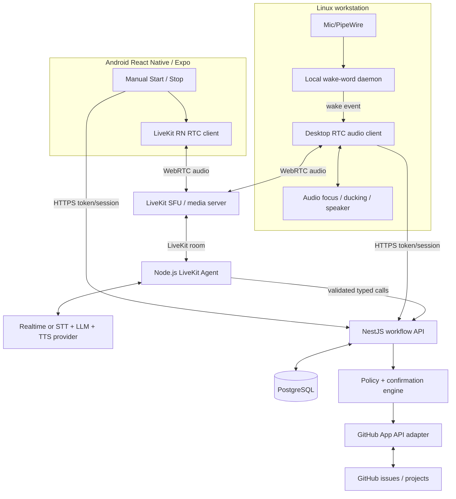
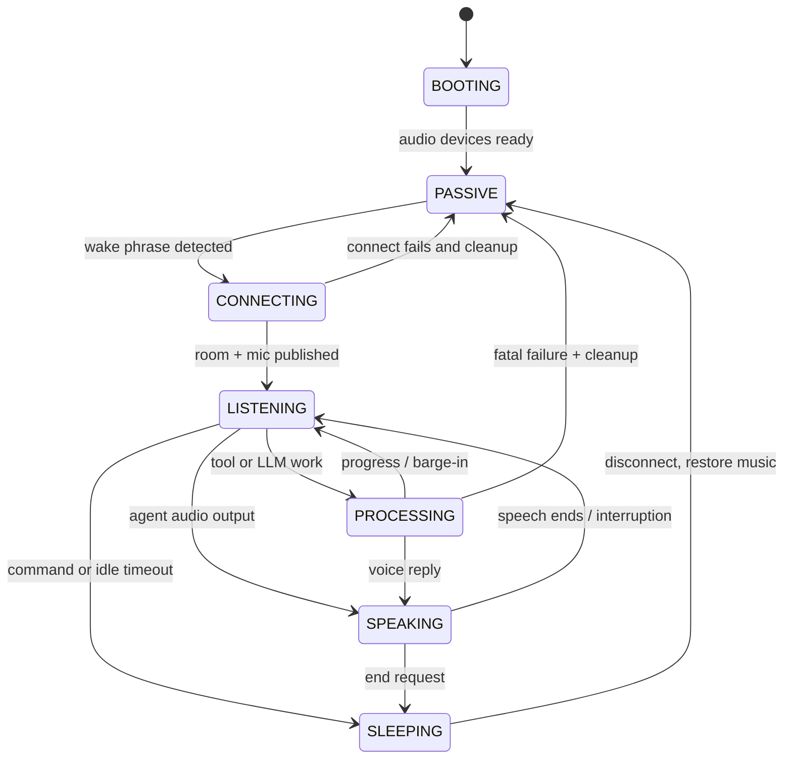

# VoiceTriage — Technical Specification

**Version:** 1.0 (proposed)  
**Date:** 2026-10-16  
**Status:** Draft; engineering implementation plan  
**Companion:** [Product Requirements Document](prd.md)

## 1. Technical decision summary

**Recommended design:** A shared **TypeScript/Node.js LiveKit voice agent** and **GitHub workflow API** serve two independent clients:

- **Linux desktop:** lightweight long-running **Python** client/daemon using local **LiveKit WakeWord** and LiveKit's native Python RTC/audio APIs. It captures only enough audio for wake inference when idle; after a wake it connects and streams audio in an authenticated LiveKit session. PipeWire handles speaker selection, optional echo cancellation/ducking, and music coexistence. Optional desktop shell/tray UI is separate from the always-on daemon.
- **Android first:** **React Native + Expo development build**, with the official LiveKit React Native SDK and **manual tap-to-start** session. No wake word, service, or background mic requirement in v1. Support Bluetooth/car audio during an intentionally active session; Android Auto integration is not in scope.
- **Backend:** a separate **NestJS/TypeScript** API for authentication/session tokens, review state, audit records, GitHub policy and permissions; a LiveKit **Node.js Agents** worker for voice/LLM/tool orchestration; **PostgreSQL** for durable state; optionally Redis if needed for coordination/queues.
- **GitHub integration:** prefer a **repository-scoped GitHub App**, with a narrow domain service that calls GitHub REST API (and GraphQL for Projects v2 when enabled). The official GitHub MCP server can accelerate a read-only proof of concept, but **do not expose unrestricted write tools directly to the LLM**.
- **Media plane:** LiveKit Cloud for easiest external-mobile MVP, with agent/business services self-hosted; self-hosted LiveKit remains a supported deployment option if the network/WebRTC requirements are met. The backend need not run on the interactive workstation, and the workstation need not be online for phone access if hosted separately.

This is a recommendation, not a claim that self-hosting is mandatory. For a local-only desktop proof of concept, run the agent and API on the workstation and use an accessible LiveKit server. For mobile away from home, design explicitly for reachability and failure recovery.

## 2. Architecture



### Component ownership

| Component | Responsibility | Runtime |
|---|---|---|
| `desktop-daemon` | Local wake classification, RTC audio, chime, mic state, device selection, volume duck/restore | Python, systemd user service on Linux |
| `mobile` | Manual session lifecycle, mic permission, Bluetooth audio, minimal status UI | React Native, Expo dev client, Android |
| `agent` | Spoken dialogue, barge-in, transcription or realtime model, non-sensitive tool orchestration, thinking audio | LiveKit Agents for Node.js, TypeScript |
| `api` | User authentication, LiveKit token minting, repo authorization, review state, proposal/confirmation, GitHub mutations, audit | NestJS/TypeScript |
| `github-adapter` | GitHub App installation tokens, read filters, REST/GraphQL, API retries and rate limiting | TypeScript package used by API |
| `database` | Accounts, linked installations, repository mappings, review sessions, pending proposals, operation logs | PostgreSQL |
| `livekit` | Secure voice media/WebRTC connectivity and room signaling | LiveKit Cloud or self-host |

### Why not put all GitHub write tools inside the agent?

LLM-generated tool parameters are an **untrusted request**, not a command authorization. The backend must independently enforce repository allowlists, typed operation permissions, expected issue state, proposal/confirmation binding, expiry, and idempotency. This is essential for voice-only approvals.

## 3. Codebase and tooling

Use a `pnpm` workspace for TypeScript, with a separate Python environment for the Linux audio daemon.

```text
voicetriage/
├── apps/
│   ├── api/                    # NestJS: auth, token service, workflow + audit
│   ├── agent/                  # @livekit/agents Node.js worker
│   ├── mobile/                 # Expo / React Native Android-first app
│   ├── desktop-daemon/         # Python: livekit-wakeword + livekit.rtc
│   └── admin-web/              # optional settings, history, status UI
├── packages/
│   ├── domain/                 # issue, review, proposal, policy types
│   ├── github/                 # GitHub App REST/GraphQL gateway
│   ├── contracts/              # zod, OpenAPI/event schemas
│   └── triage/                 # deterministic ranking + explanation inputs
├── infra/
│   ├── compose/                # Postgres, API, agent (+ LiveKit for local lab)
│   ├── systemd/                # user service for desktop-daemon
│   └── livekit/                # cloud/self-host configs, networking runbook
└── docs/
    ├── product.md
    ├── architecture.md
    ├── threat-model.md
    └── runbooks.md
```

**Version strategy:** pin working package versions and Node runtime using a lockfile and CI; do not assume a LiveKit sample's version constraints match an existing Node 20 workstation. Use supported versions verified at project initialization. Install TypeScript dependencies with **pnpm**; Python dependencies with `uv` or pinned requirements.

## 4. Desktop audio and wake-word lifecycle

### 4.1 Lifecycle state machine



**Invariant:** In `PASSIVE`, the daemon does not call cloud STT, send WebRTC audio, record ambient conversations, or run an active LLM session. It only processes local wake-classifier frames. To minimize missed commands directly after “Hey Computer,” optionally keep a **volatile local ring buffer** (e.g., 0.5–1.0 s) but do not persist it; ensure explicit privacy review before any handoff of pre-wake audio.

### 4.2 Audio chain

1. Capture microphone using platform audio API and appropriate sample-rate conversion (WakeWord expects classification input in its required format).
2. Enable OS/SDK noise suppression, automatic gain control where helpful; use PipeWire echo-cancellation with playback reference if speakers contaminate the mic. Avoid stacking two incompatible AEC stages—measure and choose the best path per device.
3. Feed local `livekit-wakeword` inference continuously. Use configurable threshold, debounce, cooldown, and activation chime.
4. When triggered, acquire authenticated session from `api`, connect to LiveKit, and start publishing microphone frames via `livekit.rtc` platform audio.
5. Duck only relevant media streams using the system's PipeWire/PulseAudio-compatible controls. Snapshot each stream's previous volume and **restore that exact stream state**, including after errors or session termination. Do not globally mute the OS or suppress other accessibility/navigation audio.
6. When user says “go to sleep” or timeout fires, close RTC tracks, stop ongoing thinking sound, restore per-stream audio, and return to local wake detection.

**Implementation note:** PipeWire's echo-cancellation module can expose a virtual echo-cancelled source/sink. Real-world wake-word behavior with music depends on microphone positioning, speaker bleed, audio routing, and classifier training; AEC is a mitigation, not a guarantee.

### 4.3 Systemd configuration

Run as a **user service** with `Restart=on-failure`, sensible backoff, audio-device availability checks, and logs without raw audio content. Provide a tray indicator and manual mic suspend switch. Handle Linux login/session restarts, device unplug events, suspend/resume, and network disconnects. Never leave the system music at a ducked volume after an unclean exit; maintain an emergency reset path or watchdog reconciliation.

### 4.4 Wake-word training and tests

Start with the published pre-trained “Hey LiveKit” model to validate plumbing, then train **“Hey Computer”** (custom ONNX). Test in quiet room, typical music volume, loud speakers, headsets, different speakers, and near-phrase dialogue. Track false accepts/hour, false rejects, time-to-trigger, and CPU usage. Do not ship untested thresholds as production defaults.

## 5. Mobile client (React Native)

- Use official LiveKit RN SDK + Expo config plugins; **Expo Go is not supported** because WebRTC requires native modules. Use development builds/EAS.
- `Start conversation` initiates mic permission request (if needed), asks backend for a short-lived room token, connects the LiveKit room, and only then enables audio.
- `End conversation` disconnects and releases mic/audio focus. No background wake listening and no implicit session start.
- Treat Bluetooth/vehicle routing, interruptions from calls/navigation, Android audio focus, route changes, and network handover as first-class lifecycle events.
- v1 only requires foreground app voice sessions. Lock-screen/background continuation is a **separate feature flag/validation item** because Android OS and foreground-service/media policies differ by version and device. Do not promise it before device testing.
- Small UI: Start/End, connection status, mute, transcript history (optional), “Review later” marker, and a read-only history screen when not driving. Avoid forcing visual confirmation of normal single-issue updates, but require stronger UI authentication for operations outside approved voice-only scope.
- **Driving safety:** instruct the user to initiate the session while parked or before departure. After that, do not require touches to continue triage. Do not advertise Android Auto integration or eligibility without a separate Android for Cars compliance review.

## 6. Voice stack, turn taking, and model choices

### Preferred MVP

LiveKit Agents Node.js manages an `AgentSession` with:

- **Option A — Managed realtime speech model:** a single low-latency speech-to-speech model, selected after measuring supported function/tool behavior and costs.
- **Option B — Modular pipeline:** streaming STT, tool-capable LLM, and streaming TTS. Often preferable where predictable tool control, text audit, and model selection are more important than absolute speech latency.

Build a provider-neutral `VoiceProvider` configuration; keep **triage scoring and GitHub writes outside** model-specific code. Use LiveKit VAD/turn detection and explicit interruption rules. Follow LiveKit's tool/turn behavior carefully: tool execution may continue after an interrupted response. Any mutation should be managed as a durable backend job, not inferred as cancelled merely because the agent's speech was interrupted.

### Thinking audio

Use LiveKit `BackgroundAudioPlayer` with a custom soft loop, or known built-in supported clips. The current official examples document keyboard sounds and office ambience; **do not assume a particular built-in `HOLD_MUSIC` enum exists** without checking the pinned SDK version. Play only in working states, e.g. after 1.5 s; stop while the assistant speaks; send a short verbal update for longer work. Allow mute and cancellation without cancelling an already-committed GitHub mutation.

## 7. GitHub domain and policy

### 7.1 Auth and permissions

- Create a **GitHub App** installed only on selected repositories.
- Request repository metadata and issue read access initially; enable **Issues write** (or equivalent specific GitHub App scopes) for allowed mutations. Projects v2 status updates need a separate GraphQL authorization/design check.
- Store private key / token material only in secret storage accessible to the backend; use short-lived installation tokens. Never expose tokens to client or LLM.
- Support repository `owner/name` allowlist, per-repository policy, and explicit user-to-installation authorization (a GitHub App token proves installation access, not which user verbally approved an action).

### 7.2 Data fetched per issue

Canonical issue URL, repository ID/name, issue number, title/body, author/assignees, labels, milestone, issue type/metadata where supported, open state, `updated_at`, timestamps, comments, explicit dependencies, Projects v2 fields if authorized and mapped, and linked references. Use pagination, bounded concurrency, conditional caching and rate-limit handling.

When querying GitHub issues, filter out pull requests from REST issue-list endpoints unless intentionally requested. Avoid asserting a decision is required unless markers or issue evidence support it.

### 7.3 Domain functions (tool contracts)

| Function | Side effect | Policy |
|---|---|---|
| `search_review_queue(filter, limit)` | No | Repo allowlist, bounded filters and results |
| `get_issue_context(repo, number)` | No | Exact issue ID, fresh fetch if stale |
| `explain_decision_options(issueRef)` | No | Clearly label inferences; never fabricate repository facts |
| `prepare_issue_update(issueRef, decision, rationale, newStatus?, labels?)` | DB only | Validate action, calculate diff, create expiring proposal |
| `confirm_issue_update(proposalId, verifiedUserTurnId)` | GitHub mutation | Verify authenticated live-session turn originated from input audio; check identity, scoped proposal, affirmative intent, expiry, state/preflight; execute once |
| `request_changes(issueRef, details)` | Requires prepare/confirm | Comment and configured status transition |
| `get_operation_status(operationId)` | No | Accurate done/partial/failed result, with GitHub readback |
| `save_review_checkpoint(reviewSessionId, cursor)` | DB only | Store review progress, never transfer a write authorization |

The `agent` calls only these typed domain operations. Consider adding official GitHub MCP **read tools** during prototyping, but write actions must pass through these guarded domain functions.

### 7.4 Per-repo workflow configuration

Example configuration (illustrative; labels/fields must be discovered and validated):

```yaml
repository: org/example
review_queue:
  any_labels: [needs-review, needs-signoff]
  status_field: Status
  status_values: [Needs Review, Blocked]
transitions:
  approve:
    add_labels: [ready-for-dev]
    remove_labels: [needs-signoff]
    project_status: Ready for Development
  request_changes:
    add_labels: [changes-requested]
    remove_labels: [ready-for-dev]
policy:
  allow_issue_comments: true
  allow_issue_body_edit: false
  allow_issue_close: false
  allow_bulk_write: false
```

For GitHub Projects v2, implement `updateProjectV2ItemFieldValue` only after resolving the Project ID, item ID, field ID, and option ID. A GitHub issue label is **not** automatically a Project field value, so adapt to each repository's actual configuration.

### 7.5 Ranking implementation

Calculate explicit features from GitHub metadata first. Run a bounded classification/summarization pass over issue descriptions/comments to identify decision needed, confidence, potential blockers, and readiness. Combine these with deterministic weighted scoring from the PRD. Store feature versions and the evidence used to justify the ranking. Use lower confidence for missing dependency/ownership data, and do not treat LLM confidence as a substitute for evidence.

## 8. Approval protocol and write safety

### 8.1 Write transaction

```mermaid
sequenceDiagram
  participant U as User voice
  participant A as LiveKit Agent
  participant P as Workflow API
  participant DB as PostgreSQL
  participant GH as GitHub
  U->>A: "Approve option B for that issue"
  A->>P: prepare(issueRef, decision, rationale)
  P->>GH: GET issue and current workflow state
  P->>DB: Store immutable proposal + expiry
  P-->>A: Proposal preview and ID
  A-->>U: Read repo/#, exact changes; "Confirm?"
  U->>A: "Confirm"
  A->>P: confirm(proposalId, verifiedUserTurnId)
  P->>DB: Atomic claim of pending proposal
  P->>GH: Preflight GET; check permissions/state
  P->>GH: Apply allowed changes (bounded steps)
  P->>GH: Read back updated issue
  P->>DB: Persist success / partial / failed + audit
  P-->>A: Verified result
  A-->>U: Speak verified result (not a guess)
```

**Proposal constraints:** bind to user ID, authenticated client session ID, exact repo/issue, normalized diff, issue `updated_at`/snapshot hash, allowed operation(s), creation time, expiry (e.g. 60 seconds), and random proposal ID. Only one confirmation per active issue/action; no cross-device or cross-session confirmations. If issue changes materially, abort and reprepare.

**Voice intent:** confirmation is accepted only as a direct answer to a pending proposal; avoid accepting unrelated “yes” in background music or media. The backend should check a signed or server-observed **fresh input-turn event** associated with the authenticated session (with timestamp and normalized affirmative intent), rather than trust a model-supplied `confirmationText` string. Do not let the LLM fabricate an authorization event. Explicit "cancel" invalidates the proposal. A completed or expired proposal cannot be replayed. Voice recognition is not treated as identity authentication. If trustworthy turn provenance is unavailable from the selected model pipeline, implement a separate short-lived confirmation recognizer/service or require stronger in-app confirmation for writes until it exists.

**Execution semantics:** store a unique operation ID and idempotency key, atomically claim proposal before network calls, use serialized processing per issue, check repo policy, and reconcile API readback. GitHub REST mutations across comments, labels, and project fields are **not one atomic transaction**. If any step fails, store the exact partial state; do not issue blind retries that duplicate comments. Include a deterministic hidden audit marker in generated comments or another safe dedupe mechanism. Offer an explicit remediation action if necessary.

**Interruption:** user barge-in stops **speech** immediately. If a write has not been committed, cancellation can invalidate the pending proposal. Once backend mutation begins, do not pretend interrupting agent audio rolled back GitHub. The agent must describe the final operation state upon reconnection.

### 8.2 Untrusted-content defense

- GitHub issue bodies, comments, repo files, linked documents, and transcripts are **data, not instructions**. Tool rights are derived exclusively from server policy and user action state.
- Restrict LLM output to schema-validated, small typed operations; reject unknown repository names, labels, fields and broad wildcard targets.
- Never use untrusted issue text to modify system prompts or GitHub token scopes.
- Make comment previews concise; HTML/Markdown sanitize on display; treat linked URLs as untrusted.

## 9. Contracts / API endpoints

The following describes **proposed internal endpoints**, not LiveKit-provided APIs.

| Route | Method | Request / result summary |
|---|---|---|
| `/v1/sessions` | POST | Authenticated client/device; return session ID, RTC room/token, expiration, conversation mode |
| `/v1/sessions/{id}` | DELETE | End or revoke active session; release pending confirmation |
| `/v1/reviews/queue` | GET | Repo filters, limit, sort; return ranked references and explanatory evidence |
| `/v1/issues/{owner}/{repo}/{number}` | GET | Authorized canonical issue snapshot |
| `/v1/write-proposals` | POST | Strict issue reference + typed change; return preview and short-lived proposal ID |
| `/v1/write-proposals/{id}/confirm` | POST | Session-bound server-verified voice-turn ID, not arbitrary LLM prose; return operation ID; execute once |
| `/v1/write-proposals/{id}` | DELETE | Cancel pending proposal |
| `/v1/operations/{id}` | GET | Pending/executing/succeeded/partially-applied/failed/needs-reconciliation |
| `/v1/reviews/checkpoint` | PUT | Store active issue, completed review order, notes, last GitHub sync time |
| `/v1/settings/audio` | GET/PUT | Wake phrase model, sensitivity, idle timeout, thinking volume, ducking preferences (desktop settings require local agent sync) |

**Example domain schema** (Zod / JSON Schema equivalent):

```ts
type IssueRef = { owner: string; repo: string; number: number };

type WriteProposal = {
  id: string;
  sessionId: string;
  userId: string;
  issue: IssueRef;
  expectedUpdatedAt: string;
  operation: 'approve' | 'request_changes';
  comment: string;
  addLabels: string[];
  removeLabels: string[];
  projectStatus?: string;
  expiresAt: string;
  state: 'pending' | 'claimed' | 'cancelled' | 'expired' | 'completed';
};

type OperationResult = {
  operationId: string;
  status: 'executing' | 'succeeded' | 'partial' | 'failed' | 'reconcile';
  verifiedMutations: Array<{ kind: string; result: string }>;
  issueUrl: string;
  completedAt?: string;
};
```

## 10. Persistent data model

Suggested tables:

| Table | Core fields | Notes |
|---|---|---|
| `users` | id, auth_provider_subject, settings | Backend identity independent of GitHub token |
| `devices` | id, user_id, kind, last_seen, display_name | Linux and Android differentiated |
| `github_installations` | installation_id, account_id, owner, permission_snapshot | Secrets referenced externally, not plain text |
| `repositories` | github_repo_id, owner, name, installation_id, enabled | Strict allowlist |
| `repository_policy` | repo_id, queue_rules, transition_rules, versions | Snapshot policy version in proposal |
| `review_sessions` | id, user_id, active_issue_ref, queue_snapshot, started_at, ended_at | Cross-device continuity of review state |
| `conversation_turns` | id, session_id, role, redacted_text, timestamp | Optional / configurable retention |
| `write_proposals` | id, session_id, user_id, issue_ref, diff_json, expected_updated_at, expiry, state | One-use approval intent |
| `operations` | id, proposal_id, idempotency_key, state, attempt_no, final_result, timestamps | Durable write accounting |
| `operation_events` | id, operation_id, event_type, detail, created_at | Per-step audit / reconciliation |

Use migrations (e.g., Prisma), row-level authorization at API boundary, DB constraints for unique idempotency keys, encryption at rest, and least-privilege DB accounts. Consider separating transcript retention from immutable operation audit retention.

## 11. Networking, hosting, and security boundaries

### Suggested first deployment

- **Linux workstation:** `desktop-daemon` as `systemd --user`, talking outbound to public/managed LiveKit and the authenticated API.
- **Always-on host or managed backend:** NestJS API + agent worker + PostgreSQL. If the workstation sleeps, the phone must still reach these services. Local Docker Compose is fine for a workstation-only proof of concept.
- **Media:** use LiveKit Cloud for first remote-access iteration, or self-host LiveKit on a reachable server with TLS and the necessary WebRTC ports/TURN. **A normal HTTPS reverse proxy or Cloudflare Tunnel alone does not solve WebRTC UDP/TURN connectivity**; explicitly test ICE, TURN/TLS, cellular handover, and carrier-grade NAT.
- **Authentication:** short-lived signed LiveKit room tokens scoped to one user session and limited room grants; use HTTPS for API; avoid embedding API secrets in clients.
- **Audio/privacy:** DTLS/WebRTC in transit; model providers may process active-session content under selected plan/provider terms; no idle audio uploaded.

Official self-host guidance includes signaling through TLS and ICE/UDP, fallback ICE/TCP, and optional TURN; configure firewalls intentionally instead of opening ports speculatively.

### Threat model summary

| Threat | Control |
|---|---|
| Unauthorized person speaks into unlocked desk mic | Active authenticated session, narrow capabilities, explicit readback; desktop lock state can suspend writes; optional second-factor for sensitive actions |
| Malicious issue comment instructs agent to write | Structured constrained tools, untrusted text treated as data, backend policy check |
| Compromised token / mobile app | Short-lived room/session tokens, backend-held GitHub App credentials, scoped installation permissions, revocation |
| Write replay after interrupted session | Expiring one-use proposals, DB claim, operation ledger, idempotency + reconciliation |
| Remote audio connection exposure | Authenticated tokens, encrypted transports, server ACLs, no public anonymous room access |
| Accidentally persistent audio collection | Strict idle state with local inference only, microphone indicator, no background mobile capture, privacy tests |

## 12. Reliability and observability

Implement structured events for `wake_detected`, `wake_false_positive_feedback`, `session_started`, `session_ended`, `audio_route_changed`, `turn_started`, `agent_interrupted`, `tool_started`, `tool_progress`, `tool_completed`, `proposal_prepared`, `proposal_confirmed`, `operation_started`, `operation_reconciled`, and `issue_updated`.

**Metrics:** wake false-accepts/rejects, session start failures, time to first audio, barge-in delay, tool p50/p95, GitHub rate-limit events, partial write frequency, reconnect success, audio routing changes, and desktop music restoration failures. Redact issue data/secrets from telemetry by default; allow debugging trace retention only by explicit opt-in.

**Error behavior:** GitHub 403/404 distinguish access denial from missing issue; 409/changed snapshot triggers re-review; 429/rate limiting backs off without duplicate writes; HTTP/network ambiguity triggers reconcile-by-read before a retry. Tool response should present an operation ID when uncertain.

## 13. Test plan

### Unit and contract tests

- Queue filtering/ranking with synthetic cross-repository issue fixtures.
- State machine: idle → wake → connect → converse → sleep, including errors.
- Policy rules: one issue at a time, allowlist, exact labels/fields, expiry, affirmative language, stale-state handling.
- GitHub adapter: pagination, rate limiting, comment dedupe, project field mappings, partial failure.
- No side effects from unconfirmed prompts or malicious issue text.

### Integration tests

- Mocked LiveKit session + agent tool calls against seeded GitHub API fixtures.
- Actual authorized staging/test GitHub repository with GitHub App, including write and readback.
- Two concurrent sessions attempt to modify same issue: only valid pending action may complete; second revalidates.
- Kill worker mid-write and ensure reconciliation without duplicate comment.
- Network disconnect while thinking or committing; result retrieved by operation ID after reconnect.

### Desktop hardware tests

- Music playing from speakers/headphones; wake with varying noise, threshold, distance.
- AEC calibration with PipeWire playback reference and normal speaker volume.
- Mic unplug, headphone switch, suspend/resume, force-kill during ducking, user service restart.
- Measure memory/CPU when passive and compare against target platform budget.

### Mobile device tests

- Android foreground start/end, Bluetooth headset and car pairing, music navigation coexistence.
- Phone call interruption; screen lock behavior documented (not promised if unsupported).
- Wi-Fi ↔ cellular handover, low bandwidth, intermittent 4G/5G coverage, 30-second outage, resume checkpoint.
- Driving-mode usability inspection: no mid-drive screen-read tasks required for routine review.

### Release gates

- **Zero unexpected GitHub mutations** in all automated and manual test suites.
- Core success + partial failure + cancellation flows demonstrated on both clients.
- Measured wake and latency targets from PRD reported, with documented environmental limits.
- Secret scanning, auth/rate-limit testing, security review of spoken authorization and adversarial repo content.

## 14. Detailed implementation increments

**Increment 1 — Repo read vertical slice:** configure backend and one GitHub installation; load issue details and ranked queue; verify issue numbers and source references. No write permissions yet.

**Increment 2 — Realtime voice baseline:** Node LiveKit agent and one managed speech provider; add desktop audio client and Android RN starter with manual session. Prove interruptions and short responses on cellular network.

**Increment 3 — Desktop wake:** Linux Python wake daemon, initial pre-trained phrase, systemd, mic/devices; then custom “Hey Computer,” speaker tests, noise control, music ducking/restore.

**Increment 4 — Mutations:** GitHub App Issues write; typed commands; prepare/confirm/execute; DB ledger; stale checks, comment dedupe, verification; simulated adversarial speech and issue text.

**Increment 5 — Mobility/polish:** Bluetooth/audio focus validation, cross-device checkpoints, optional thinking audio, operations progress, reconnect and privacy settings.

**Increment 6 — Production hardening:** app update path, monitoring, secret rotation, issue/project policy editor, self-hosted media feasibility test, separate Android background-session research if desired.

## 15. ADRs (architecture decision records)

- **ADR-001: Shared backend agent, separate clients.** Chosen to keep GitHub logic, authorization and review state consistent across desktop/mobile.
- **ADR-002: Desktop passive wake locally; mobile manually activated.** Chosen for privacy, audio reliability, simpler mobile platform compliance and explicit user intent.
- **ADR-003: Domain API controls writes; model is not authority.** Chosen to prevent prompt injection, unintended updates and untraceable approvals.
- **ADR-004: First release Android-first, no Android Auto.** Chosen because a standard React Native app can provide a useful car Bluetooth voice experience without promising head-unit compatibility.
- **ADR-005: Managed media plane first, self-host optional.** Chosen to reduce NAT/TURN complexity during validation while keeping business services self-hostable.
- **ADR-006: Short-term durable review state, not persistent RTC call across devices.** New sessions load checkpoints and fresh GitHub data; pending approval does not transfer.
- **ADR-007: Local daemon in Python initially.** Chosen because official wake-word and microphone/RTC support are available. Could migrate a proven daemon to Rust later; TS remains primary business-logic language.

## 16. Known uncertainties / spike checklist

1. Benchmark the target workstation's microphone, speaker routing and normal music volume; tune wake model and AEC before claiming production reliability.
2. Validate Python RTC platform audio support and Linux device lifecycle on actual Ubuntu/PipeWire setup.
3. Confirm current LiveKit Node SDK, model provider, and Expo native dependency compatibility in a pinned build; avoid copying deprecated example code blindly.
4. Test Android Bluetooth / vehicle audio focus and network handoff across the target Android version and car system.
5. Determine whether GitHub Projects v2 status updates are required on day one; labels alone may not represent workflow state.
6. Decide access topology if the workstation sleeps: dedicated Linux host, cloud worker/media, or a hybrid.
7. Define repository-specific sign-off markers and human review ground truth for queue ranking.

## 17. Engineering references

These links document current platform capabilities as of the specification date. They should be rechecked against the pinned SDK versions during implementation.

- LiveKit Agents: https://docs.livekit.io/agents/
- LiveKit AgentSession: https://docs.livekit.io/agents/logic/sessions/
- LiveKit function tools and interruption rules: https://docs.livekit.io/agents/logic/tools/definition/
- LiveKit async tools / progress: https://docs.livekit.io/agents/logic/tools/async/
- LiveKit thinking/background audio: https://docs.livekit.io/agents/multimodality/audio/background-audio/
- LiveKit wake-word SDK and custom training: https://github.com/livekit/livekit-wakeword
- LiveKit wake-word design: https://docs.livekit.io/agents/multimodality/audio/wakeword/
- LiveKit Python native RTC audio: https://docs.livekit.io/reference/python/livekit/rtc/platform_audio.html
- LiveKit Expo setup: https://docs.livekit.io/transport/sdk-platforms/expo/
- LiveKit React Native starter: https://github.com/livekit-examples/agent-starter-react-native
- LiveKit self-hosted firewall/TURN requirements: https://docs.livekit.io/transport/self-hosting/ports-firewall/
- GitHub official MCP: https://github.com/github/github-mcp-server
- GitHub issues REST: https://docs.github.com/en/rest/issues
- GitHub Projects v2 GraphQL: https://docs.github.com/en/graphql/reference/projects
- GitHub Apps auth: https://docs.github.com/en/apps/using-github-apps/authorizing-github-apps
- PipeWire echo-cancel: https://pipewire.pages.freedesktop.org/pipewire/page_module_echo_cancel.html
- Android car app quality/policy: https://developer.android.com/docs/quality-guidelines/car-app-quality
